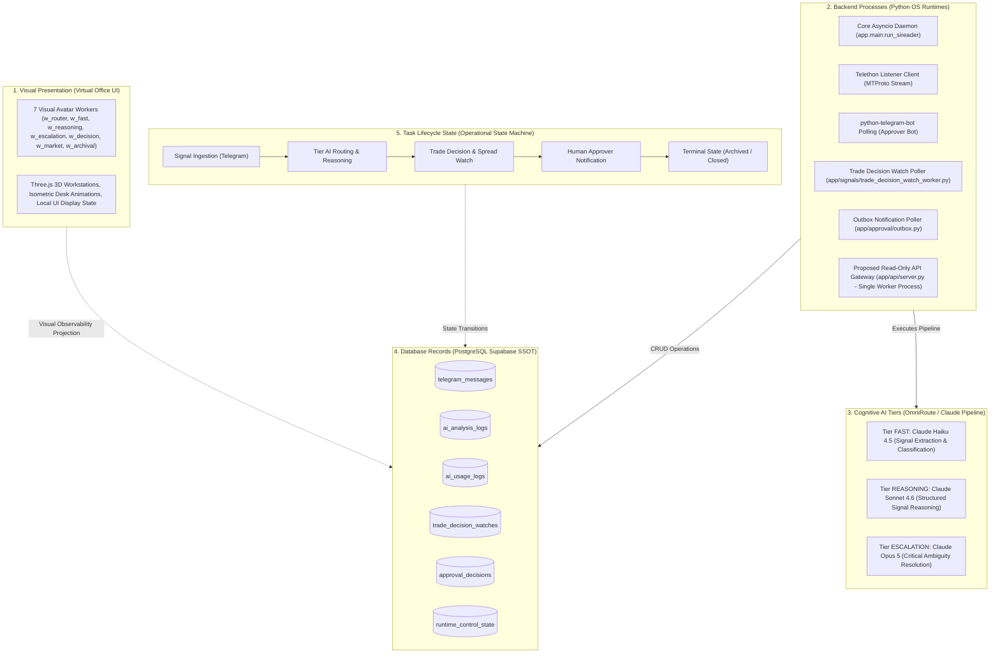
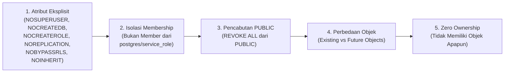
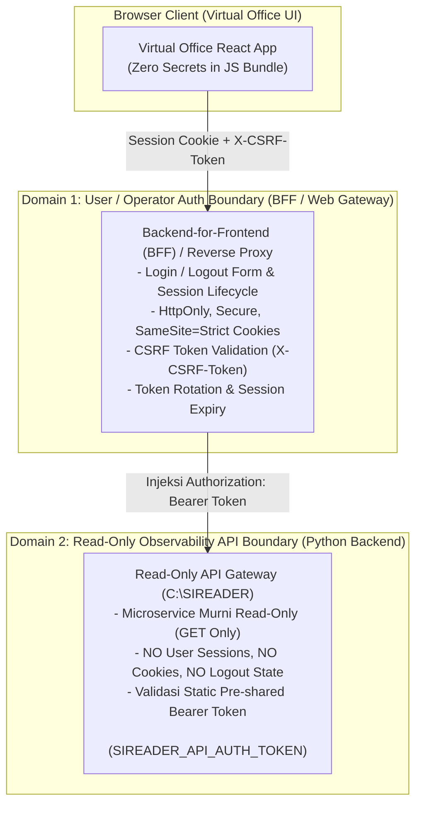
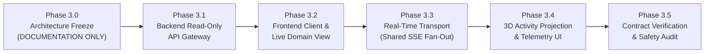

# SIREADER Phase 3 — Backend Integration Architecture
## Dokumentasi Validasi Keamanan, Kontrak Data, dan Konsistensi Runtime (Phase 3.0 Freeze)

- **Status Dokumen:** Phase 3.0 — FINAL ARCHITECTURE SANITY CHECK (DOCUMENTATION ONLY)
- **Target Integrasi:** SIREADER Python Backend (`C:\SIREADER`) $\longleftrightarrow$ SIREADER Virtual Office (`C:\Users\ASUS\...\SIREADER`)
- **Prinsip Utama:** Read-Only Observability, Pemisahan Repository & Domain Model, Multi-Layer Role Security, Zero Token Exposure, Non-Fabricated Telemetry.

---

## 1. Pemisahan Konsep Arsitektur (Disambiguasi Fundamental)

Untuk mencegah kesalahan asumsi sistemik, integrasi Phase 3 secara ketat membedakan 5 lapisan konsep yang berbeda:



### 1.1 Definisi 5 Lapisan
1. **Visual Presentation (Virtual Office UI):** Model representasi visual (7 avatar di workstation Three.js). Worker visual adalah abstraksi estetika untuk memantau alur sistem.
2. **Backend Processes (Python OS Runtimes):** Proses eksekusi nyata berarsitektur `asyncio` (`app/main.py`, worker poller, bot updater). Bukan pemetaan 1-ke-1 dengan 7 avatar visual.
3. **Cognitive AI Tiers (OmniRoute Pipeline):** Model LLM dinamis (Claude Haiku 4.5, Sonnet 4.6, Opus 5). Bukan proses worker OS yang berdiri sendiri.
4. **Database Records (PostgreSQL Supabase):** Sumber kebenaran tunggal (*Single Source of Truth*). Data transaksional dan log historis.
5. **Task Lifecycle State:** Siklus hidup sinyal dari pesan masuk hingga eksekusi terminal.

### 1.2 Koreksi Telemetri vs Audit Record
- `ai_usage_logs`: Merupakan log agregasi biaya API LLM dan konsumsi token. Diproyeksikan sebagai **Telemetri Penggunaan Sistem**, bukan sebagai status worker visual archival.
- `approval_decisions`: Merupakan catatan keputusan manual operator Telegram. Diproyeksikan sebagai **Audit Log / Audit Trail**, bukan sebagai antrean background worker.

---

## 2. Batasan Keamanan Database PostgreSQL & Proteksi Role

### 2.1 Kebijakan Keamanan Read-Only Mutlak
Phase 3 awal ditetapkan secara arsitektural sebagai **100% READ-ONLY OBSERVABILITY**.
Virtual Office berfungsi sebagai **kaca jendela pemantau (monitoring dashboard)**, bukan konsol eksekusi.

```text
+----------------------------------------------------------------------------------+
|                            STRICT SECURITY BOUNDARY                              |
|                                                                                  |
| 1. DILARANG membuat endpoint HTTP dengan metode POST, PUT, PATCH, DELETE.        |
| 2. DILARANG membuat endpoint untuk Approve atau Reject sinyal trading.           |
| 3. DILARANG membuat endpoint untuk Pause atau Resume backend.                    |
| 4. DILARANG membuat endpoint untuk mengubah RuntimeControlState / Take Profit.   |
| 5. DILARANG mengimpor modul mt5_connector fungsi eksekusi order ke dalam API.    |
| 6. Konfigurasi default (TRADING_MODE="DRY_RUN", REQUIRE_MANUAL_APPROVAL=True)     |
|    TIDAK BOLEH dijadikan alasan untuk membuka endpoint mutasi.                   |
+----------------------------------------------------------------------------------+
```

### 2.2 Penegakan Keamanan Role PostgreSQL (Role Security Hardening)

Penegakan read-only di level database tidak boleh hanya mengandalkan flag `NOINHERIT`. Dalam arsitektur PostgreSQL, atribut `NOINHERIT` hanya mencegah pewarisan izin otomatis saat sesi dimulai; pengguna tetap dapat menjalankan perintah `SET ROLE <privileged_role>` jika memiliki keanggotaan (*membership*) pada role tersebut.

Oleh karena itu, keamanan role `sireader_api_ro` ditegakkan dengan aturan keras:



1. **Atribut Keamanan Role Eksplisit:**
   - Role API wajib dideklarasikan dengan parameter paling restriktif:
     `NOSUPERUSER NOCREATEDB NOCREATEROLE NOREPLICATION NOBYPASSRLS NOINHERIT`.
2. **Isolasi Keanggotaan (Zero Membership):**
   - Role `sireader_api_ro` **dilarang keras** dijadikan anggota dari role `postgres`, `service_role`, `authenticated`, `anon`, atau role pemilik aplikasi utama. Hal ini mencegah eksekusi eskalasi hak via `SET ROLE`.
3. **Pencabutan Hak Akses `PUBLIC`:**
   - Seluruh izin default yang diberikan PostgreSQL kepada pseudo-role `PUBLIC` pada skema `public` (tabel, sequences, fungsi administratif) wajib dicabut untuk role ini.
4. **Pembedaan Hak Objek Eksisting vs Objek Masa Depan:**
   - **Pencabutan Objek yang Sudah Ada (*Existing Objects*):** Perintah `REVOKE ALL ON ALL TABLES/SEQUENCES/FUNCTIONS IN SCHEMA public FROM sireader_api_ro;` hanya mencabut privilege dari objek yang *sudah tercipta saat perintah dijalankan*.
   - **Penetapan Hak Objek Masa Depan (*Future Objects*):** Perintah `ALTER DEFAULT PRIVILEGES FOR ROLE <creator_role> IN SCHEMA public REVOKE ALL ON TABLES/SEQUENCES/FUNCTIONS FROM sireader_api_ro;` wajib menentukan klausul `FOR ROLE <creator_role>` (misal `FOR ROLE postgres` atau `FOR ROLE supabase_admin`), karena tanpa `FOR ROLE`, perintah hanya berlaku untuk objek yang dibuat oleh role sesi yang sedang aktif.
5. **Zero Object Ownership:**
   - Role `sireader_api_ro` tidak boleh memiliki objek tabel, view, atau schema apa pun di database.
6. **Protokol Audit Verifikasi Privilege Efektif:**
   Sebelum role dinyatakan aman, kueri verifikasi berikut wajib dijalankan pada Milestone 3.1:
   ```sql
   -- 1. Verifikasi membership (harus 0 baris)
   SELECT * FROM pg_auth_members WHERE member = 'sireader_api_ro'::regrole;

   -- 2. Verifikasi kepemilikan objek (harus 0 objek)
   SELECT relname, relkind FROM pg_class WHERE relowner = 'sireader_api_ro'::regrole;

   -- 3. Verifikasi ketiadaan hak skema (harus false)
   SELECT has_schema_privilege('sireader_api_ro', 'public', 'CREATE');

   -- 4. Verifikasi privilege efektif tabel & view (hanya SELECT pada view/allowlist)
   SELECT table_name, privilege_type
   FROM information_schema.table_privileges
   WHERE grantee IN ('sireader_api_ro', 'PUBLIC') AND table_schema = 'public';
   ```
7. **Rancangan Script SQL Konfigurasi Role API (PROPOSED SPECIFICATION):**
   *(PERINGATAN: Sesuai aturan keselamatan Phase 3.0, skrip ini HANYA RANCANGAN ARSITEKTUR dan TIDAK DIJALANKAN sekarang).*
   ```sql
   -- DRAFT RANCANGAN KONFIGURASI ROLE DATABASE READ-ONLY (PHASE 3.1)
   -- 1. Buat role dengan atribut keamanan terkunci penuh
   CREATE ROLE sireader_api_ro WITH
       LOGIN
       NOSUPERUSER
       NOCREATEDB
       NOCREATEROLE
       NOREPLICATION
       NOBYPASSRLS
       NOINHERIT
       PASSWORD '<managed-ro-secret>';

   GRANT CONNECT ON DATABASE postgres TO sireader_api_ro;
   GRANT USAGE ON SCHEMA public TO sireader_api_ro;

   -- 2. Pastikan tidak ada membership ke role istimewa
   REVOKE postgres, authenticated, service_role FROM sireader_api_ro;

   -- 3. Cabut privilege pada objek yang SUDAH ADA
   REVOKE ALL ON ALL TABLES IN SCHEMA public FROM sireader_api_ro;
   REVOKE ALL ON ALL SEQUENCES IN SCHEMA public FROM sireader_api_ro;
   REVOKE ALL ON ALL FUNCTIONS IN SCHEMA public FROM sireader_api_ro;

   -- 4. Cabut privilege default untuk objek yang AKAN DIBUAT di masa depan
   ALTER DEFAULT PRIVILEGES FOR ROLE postgres IN SCHEMA public REVOKE ALL ON TABLES FROM sireader_api_ro;
   ALTER DEFAULT PRIVILEGES FOR ROLE postgres IN SCHEMA public REVOKE ALL ON SEQUENCES FROM sireader_api_ro;
   ALTER DEFAULT PRIVILEGES FOR ROLE postgres IN SCHEMA public REVOKE ALL ON FUNCTIONS FROM sireader_api_ro;

   -- 5. Penegasan pemblokiran mutasi DML
   REVOKE INSERT, UPDATE, DELETE, TRUNCATE, REFERENCES, TRIGGER
   ON ALL TABLES IN SCHEMA public FROM sireader_api_ro;
   ```

### 2.3 Sanitasi Data Sensitif & Arsitektur Database View
Untuk mencegah kebocoran data (*data overexposure*), evaluasi terhadap 11 tabel allowlist mengidentifikasi sejumlah kolom sensitif yang **dilarang dipublikasikan ke frontend**:
- `telegram_messages.sender`: Berpotensi membocorkan identitas, username, atau nomor telepon mentor Telegram $
ightarrow$ Dikecualikan dari DTO publik atau dimasking.
- `ai_analysis_logs.result_json`: Berisi raw prompt context, system instructions, dan output mentah LLM $
ightarrow$ Hanya diekstrak field struktural observasi (`status`, `extracted`, `decision`), dilarang keras mengirim raw text dump secara utuh.
- `approval_decisions.reviewer`: Berisi identitas ID internal reviewer Telegram $
ightarrow$ Dimasking menjadi nama peran generik (misal: "Authorized Approver").
- `telegram_notification_outbox.recipient_chat_id`: Berisi ID chat Telegram internal penerima notifikasi $
ightarrow$ Dikecualikan dari DTO publik.
- `trade_decision_watches.broker_server`: Berisi alamat IP/domain host server broker MT5 internal $
ightarrow$ Dikecualikan dari DTO publik.

#### A. Perbandingan Model Keamanan View: Default View vs security_invoker
Di PostgreSQL, terdapat perbedaan fundamental dalam penegakan izin view yang harus dievaluasi secara cermat:

```text
+------------------------------------------------------------------------------------+
|                POSTGRESQL VIEW SECURITY MODEL COMPARISON                           |
+------------------------------------+-----------------------------------------------+
| FITUR                              | DEFAULT VIEW (Owner-Based)  | SECURITY_INVOKER (PG 15+)     |
+------------------------------------+-----------------------------+-----------------+
| Hak Akses Tabel Dasar              | Dievaluasi thd Pemilik View | Dievaluasi thd Pemanggil View |
| Izin yang Dibutuhkan API Role      | Hanya SELECT pada View      | SELECT (kolom) pd Tabel Dasar |
| Penegakan Row-Level Security (RLS) | Di-BYPASS jika owner super  | DITEGAKKAN thd pemanggil      |
| Isolasi Kolom Sensitif Tabel       | Mutlak (tabel dasar ditutup)| Membutuhkan column-level grant|
+------------------------------------+-----------------------------+-----------------+
```

1. **Model Default View Security (Owner-Based Permissions):**
   - Secara default di PostgreSQL, query pada view dijalankan menggunakan privilege dari **pemilik view (view owner)**.
   - **Mekanisme Akses Aman:** Role `sireader_api_ro` **HANYA** diberi hak `GRANT SELECT ON v_api_*` dan **SAMA SEKALI TIDAK DIBERI** hak `SELECT` pada tabel fisik dasar (`public.telegram_messages`, dll.).
   - Dengan model ini, kolom sensitif (`sender`, `result_json`, dll.) terisolasi secara matematis karena API role tidak memiliki izin membaca tabel mentahnya sama sekali.
   - **Pertimbangan RLS & Owner:** Jika view dimiliki oleh role superuser (`postgres`), view ini secara inheren akan mengabaikan Row-Level Security (RLS) pada underlying table. View owner harus dikelola secara disiplin (misal: dimiliki oleh role terisolasi).
2. **Model `security_invoker = true` (PostgreSQL 15+):**
   - Jika view dideklarasikan dengan `WITH (security_invoker = true)`, PostgreSQL mengevaluasi hak akses dan kebijakan RLS terhadap pengguna pemanggil (*invoker*), yaitu `sireader_api_ro`.
   - **Konsekuensi:** Role `sireader_api_ro` harus diberikan izin `SELECT` eksplisit pada tabel dasar (minimal column-level grant pada kolom non-sensitif). Seluruh policy RLS pada tabel dasar akan diterapkan secara ketat.

#### B. Peringatan Validasi Kritis: Larangan Klaim Aman Prematur
> [!WARNING]
> **DILARANG MENGKLAIM VIEW INI SUDAH PASTI AMAN SEBELUM MEKANISMENYA DIVERIFIKASI SECARA EMPIRIS.**
> Pada Milestone 3.1, arsitektur view ini wajib diuji di database Supabase riil dengan memverifikasi:
> 1. Versi PostgreSQL Supabase (memastikan kapabilitas `security_invoker`).
> 2. Kepemilikan view (`pg_views.viewowner`).
> 3. Status aktif RLS (`pg_tables.rowsecurity`) pada seluruh tabel dasar.
> 4. Uji penetrasi query langsung: memastikan `sireader_api_ro` ditolak saat mencoba `SELECT * FROM public.telegram_messages;` dan hanya diizinkan membaca `v_api_telegram_messages`.

```sql
-- DRAFT RANCANGAN DATABASE OBSERVABILITY VIEWS (PHASE 3.1)
CREATE VIEW v_api_telegram_messages AS
    SELECT id, message_id, chat_id, date, text, channel_name, created_at
    FROM public.telegram_messages;

CREATE VIEW v_api_ai_analysis_logs AS
    SELECT id, message_id, tier, status, retry_count, latency_ms, created_at, updated_at
    FROM public.ai_analysis_logs;

CREATE VIEW v_api_trade_decision_watches AS
    SELECT id, message_id, epic, direction, status, target_spread, last_spread, last_checked_at, created_at
    FROM public.trade_decision_watches;

-- Berikan izin SELECT HANYA pada View terfilter kepada sireader_api_ro
GRANT SELECT ON v_api_telegram_messages, v_api_ai_analysis_logs, v_api_trade_decision_watches TO sireader_api_ro;
```

---

## 3. Autentikasi Frontend & Manajemen Rahasia (Secrets Governance)

### 3.1 Larangan Keras Anti-Pattern Token Vite
```text
+----------------------------------------------------------------------------------+
|                        CRITICAL SECURITY ANTI-PATTERN                            |
|                                                                                  |
| DILARANG KERAS menaruh token autentikasi (SIREADER_API_AUTH_TOKEN) sebagai      |
| variabel VITE_* (misal: VITE_API_TOKEN) dalam kode atau konfigurasi frontend!    |
|                                                                                  |
| ALASAN TEKNIS:                                                                   |
| Seluruh variabel berawalan VITE_* akan di-bundle langsung oleh Vite compiler     |
| ke dalam file JavaScript statis publik (dist/assets/*.js). Rahasia apapun yang   |
| disimpan di sana DAPAT DIBACA SECARA TERBUKA oleh siapa saja melalui DevTools.    |
+----------------------------------------------------------------------------------+
```

### 3.2 Pemisahan Batas Autentikasi (Authentication Boundary Decoupling)

Secara arsitektur, integrasi memisahkan secara tegas dua domain autentikasi yang berbeda:



#### A. Domain 1: User / Operator Session Boundary (BFF / Web Gateway Layer)
- Berada di sisi frontend gateway / reverse proxy untuk melayani operator manusia.
- Mengelola formulir login, siklus hidup sesi, dan pembatalan sesi (*logout*).
- **Session Security:**
  - `HttpOnly`: Mencegah script pihak ketiga atau celah XSS membaca cookie sesi.
  - `Secure`: Cookie hanya dikirimkan melalui saluran terenkripsi TLS/HTTPS.
  - `SameSite=Strict`: Mencegah pengiriman cookie pada request lintas situs.
- **Perlindungan CSRF & Token Rotation:**
  - Header kustom `X-CSRF-Token` divalidasi oleh BFF pada request terproteksi.
  - Sesi memiliki batas kedaluwarsa ketat (*idle timeout* 1–2 jam, *absolute expiration* 8 jam).
  - Jika BFF menggunakan mekanisme token refresh, terapkan *single-use token rotation* dengan deteksi pemakaian ulang.
  - Endpoint `/auth/logout` berada di lapisan BFF ini untuk menghapus sesi server dan membersihkan cookie klien.

#### B. Domain 2: Read-Only Observability API Boundary (Python Backend Layer)
- Berada di dalam Python backend (`C:\SIREADER`).
- Layanan ini berstatus **decoupled microservice murni read-only**.
- **TIDAK MENGELOLA** session cookie browser, login form pengguna, tabel akun pengguna, atau endpoint logout.
- **HANYA** memvalidasi token bearer statis / pre-shared service key (`SIREADER_API_AUTH_TOKEN`) yang dikirim melalui header standar `Authorization: Bearer <token>`.
- **Injeksi Transport Bearer:**
  - **Local Development:** Vite Dev Server Proxy menyisipkan header `Authorization: Bearer <token>` dari file `.env` lokal OS sisi server saat mem-forward request `/api/*` ke API Gateway `127.0.0.1:8000`. Browser bundle tidak pernah menyimpan secret token.
  - **Production Deployment:** BFF/Reverse Proxy menyisipkan token secara internal di private network / socket loopback.

---

## 4. Arsitektur Real-Time SSE: Multi-Client Safety & Shared Publisher

### 4.1 Batasan Proses & Single-Worker Constraint
Singleton in-memory poller (`SharedPoller`) **hanya berlaku pada satu proses OS**. Dalam lingkungan tanpa distributed message broker (seperti Redis), menjalankan multiple worker processes (misal: `uvicorn --workers 4`) akan memicu duplikasi query polling database ke Supabase sebanyak jumlah proses.

- **Keputusan Arsitektur:** Pada Phase 3.1, API Gateway **ditetapkan berjalan secara eksklusif dengan 1 proses worker** (`workers = 1`).
- Kemampuan multi-proses atau multi-instance ditangguhkan sampai tersedianya shared broker terverifikasi (ditandai sebagai `OPEN DECISION`).

### 4.2 Pola Bounded Queue & Penanganan Slow Consumer
Untuk mencegah satu klien browser yang lambat atau terhenti (*slow consumer*) menyebabkan kebocoran memori (*memory leak*) pada API Gateway, setiap koneksi SSE dialokasikan antrean bertipe **bounded queue**:

```mermaid
flowchart LR
    Broadcaster["Shared Broadcaster Hub"] -->|push event| BoundedQ["asyncio.Queue (maxsize=100)"]
    BoundedQ -->|get_nowait| ClientWriter["SSE Response Stream Writer"]

    BoundedQ -.->|Jika Queue Penuh
(QueueFull Error)| DropHandler["Tindakan Proteksi:
1. Jangan blokir broadcaster
2. Putus koneksi klien lambat
3. Kirim event 'resync_required'"]
```

1. **Kapasitas Antrean Terbatas (`maxsize = 100`):** Setiap klien SSE memiliki antrean `asyncio.Queue(maxsize=100)`.
2. **Kebijakan Saat Overflow (`QueueFull`):**
   - Broadcaster menggunakan `queue.put_nowait(event)`.
   - Jika antrean klien penuh (karena jaringan klien macet), broadcaster **TIDAK BOLEH MENUNGGU ATAU MEMBLOKIR** antrean klien lain.
   - Antrean yang penuh langsung ditutup; koneksi klien lambat tersebut diputus paksa dengan status penutupan stream.
   - Klien yang terputus diwajibkan melakukan reconnect otomatis dan melakukan *Full State REST Resynchronization* untuk mengatasi gap data.

### 4.3 Pemisahan Heartbeat vs Ambang Batas Terputus (Disconnected Threshold)
- **Interval Heartbeat Server:** Server mengirim event komentar SSE `: ping\n\n` setiap **15 detik**.
- **Ambang Batas DISCONNECTED Klien:** Klien frontend hanya menyatakan koneksi berstatus `DISCONNECTED` jika **tidak menerima event data maupun ping selama $\ge 30$ detik** (toleransi 2 siklus heartbeat terlewat). Hal ini mencegah fluktuasi visual akibat latensi jaringan sesaat.

### 4.4 Event Gap Recovery & Resynchronization
- Setiap event memiliki field `id: <monotonic_seq>`.
- Client menyimpan `Last-Event-ID` terakhir yang berhasil diproses.
- Gateway menyimpan *Ring Buffer* memori (100 event terakhir).
- Jika client reconnect dengan `Last-Event-ID` yang masih ada di ring buffer, gateway mengirimkan delta event yang tertinggal.
- Jika `Last-Event-ID` sudah terhapus dari ring buffer (karena diskoneksi terlalu lama), gateway mengirimkan event instruksi `event: reset_state`, yang memerintahkan Virtual Office membersihkan state lokal dan melakukan kueri penuh ke REST API.

---

## 5. Target Benchmark Kueri Database & Pengendalian Sumber Daya Supabase

### 5.1 Parameter Alokasi Koneksi (Target Hipotesis Awal)
Database Supabase diakses melalui Supavisor Shared Pooler (port 5432, session mode). Seluruh angka alokasi berikut berstatus **hipotesis awal yang belum diverifikasi** (*unverified target hypothesis*):

```text
+----------------------------------------------------------------------------------+
|                   CANDIDATE CONNECTION POOL ALLOCATION TARGET                    |
|                                                                                  |
| 1. Core Telegram Daemon (app/main.py):      pool_size=3, max_overflow=2 (Target) |
| 2. API Gateway Service (app/api/server.py):  pool_size=2, max_overflow=0 (Target) |
| 3. Cadangan Administrasi, Migrasi & Debug:   Alokasi sisa pool                   |
+----------------------------------------------------------------------------------+
```

### 5.2 Protokol Benchmarking Empiris (Milestone 3.1)
Klaim kapasitas beban database dan QPS dilarang diasumsikan secara spekulatif. Efisiensi sistem wajib diukur melalui protokol benchmark dengan metode pengukuran yang jelas:

#### A. Metrik yang Diukur Secara Empiris:
1. **Pooler Connection Wait Time & Queued Clients:** Waktu tunggu akuisisi koneksi dari Supavisor (diukur via `pg_stat_activity` dan metrik pooler).
2. **Database CPU & Memory Utilization:** Utilisasi resource pada Supabase Compute Dashboard.
3. **Query Execution Latency (p50, p95, p99):** Durasi eksekusi kueri agregat yang tercatat pada `pg_stat_statements`.
4. **Bandwidth & Network Egress:** Volume data transfer antara database dan API Gateway.

#### B. Protokol Pengujian 3 Tahap:
1. **Fase 1 (Baseline Measurement):** Mengukur metrik database selama 10 menit dengan hanya Core Telegram Daemon yang aktif tanpa API Gateway.
2. **Fase 2 (Single-Worker Poller Benchmark):** Mengaktifkan API Gateway single-worker (`workers = 1`) dengan SharedPoller. Menguji tiga nilai polling interval kandidat: **1.5 detik**, **2.0 detik**, dan **3.0 detik**. Mencatat peningkatan CPU, connection wait time, dan query latency.
3. **Fase 3 (Multi-Client Fan-Out Verification):** Menghubungkan 1, 5, dan 10 klien browser virtual ke SSE stream secara bersamaan. Memverifikasi bahwa jumlah kueri ke Supabase dan utilisasi CPU database tetap konstan (beban database tidak bertambah seiring pertambahan klien).

#### C. Ambang Batas Evaluasi & Penyesuaian:
- Jika utilisasi CPU database idle meningkat $> 15\%$ atau connection wait time $> 50$ms pada interval 1.5s, maka polling interval wajib disesuaikan menjadi **2.0s – 3.0s**.
- Mengoptimalkan kueri dengan filter inkremental (`WHERE updated_at > :last_poll_timestamp`) untuk mencegah full table scan.

---

## 6. Proyeksi Aktivitas Visual Berbasis Bukti Nyata & Liveness Semantics

### 6.1 Disambiguasi Timestamp: created_at vs updated_at vs last_progress_at vs Heartbeat
Dalam database PostgreSQL backend dan alur observasi, terdapat 5 dimensi timestamp yang harus dibedakan secara tegas:
- `created_at`: Waktu record pertama kali dibuat. **Dilarang keras menyimpulkan worker visual sedang BUSY hanya berdasarkan usia `created_at`** (misal: pesan yang dibuat 10 menit lalu tidak membuktikan ada worker yang memprosesnya saat ini jika tidak ada record aktif yang cocok).
- `updated_at`: Waktu baris data terakhir kali diubah oleh engine pemroses.
- `last_checked_at`: Timestamp pengecekan spread MT5 terakhir pada `trade_decision_watches`.
- `last_progress_at`: Timestamp checkpoint kemajuan internal tahapan reasoning/ekstraksi (jika disediakan oleh pipeline), bukan bukti denyut liveness proses itu sendiri.
- `heartbeat`: Sinyal denyut nadi liveness aktif periodik dari worker process OS.

**Fakta Kritis & Batasan Diagnostik:**
> [!IMPORTANT]
> **Python backend saat ini BELUM MEMILIKI PER-WORKER HEARTBEAT YANG DAPAT DIPERCAYA.**
> Oleh karena itu, Virtual Office **DILARANG** mengklaim bahwa worker visual "pasti sedang bekerja" (*confirmed busy*) atau menyimpulkan worker "pasti mengalami crash" (*hard crash*). Proyeksi 3D hanya merefleksikan status data record yang teramati secara probabilistik (*unconfirmed inference*).

### 6.2 Spektrum Liveness Visual (Enam Status Resmi)

```text
+-------------------+---------------------------------------+----------------------------------+
| STATUS SISTEM     | STATUS PROYEKSI VISUAL                | MAKNA & PRESENTASI VISUAL 3D     |
+-------------------+---------------------------------------+----------------------------------+
| In-flight Update  | BUSY (Inferred, Unconfirmed Heartbeat)| Inferensi LLM normal, hijau      |
| In-flight Lambat  | LINGERING (Latency Alert)             | Inferensi melambat, amber kedip  |
| In-flight Mandek  | STALE (In-flight Timeout Warning)     | Record macet, badge oranye       |
| Tidak ada task    | QUIET (Business Idle)                 | Standby tenang normal, hijau redup|
| Watch Spread MT5  | OBSERVING                             | Radar pemantau amber lambat      |
| Transport Putus   | DISCONNECTED                          | Workstation abu-abu transparan   |
| Database Down     | DB_UNAVAILABLE                        | Peringatan koneksi DB merah      |
| Anomali Data      | UNKNOWN                               | Indikator tanda tanya abu-abu    |
+-------------------+---------------------------------------+----------------------------------+
```

1. **`BUSY` (atau `INFERRED_BUSY`):**
   - Terjadi HANYA jika ada record transaksi *in-flight* yang aktif (misal: `ai_analysis_logs.status = 'PROCESSING'`) dan usia pembaruan data $now - updated\_at \le 120$ detik.
   - Presentasi: Avatar aktif mengetik, indikator meja hijau aktif. Tetap berstatus inferensi tanpa jaminan proses worker OS hidup.
2. **`LINGERING` ($121 \le age \le 180$ detik):**
   - Terjadi jika record *in-flight* masih `PROCESSING` namun usianya antara 121–180 detik.
   - Presentasi: Avatar pose berpikir tertahan, indikator amber berkedip lambat (peringatan latensi upstream LLM).
3. **`QUIET` (Business Idle - BUKAN STALE):**
   - Kondisi normal saat koneksi API Gateway dan database berjalan sehat, namun **tidak ada pesan baru atau task aktif** (misalnya saat pasar sepi, malam hari, atau akhir pekan).
   - **Ketiadaan aktivitas baru selama $> 180$ detik sama sekali BUKAN data stale!** Sistem yang tenang adalah kondisi bisnis normal.
   - Presentasi: Workstation berada dalam pose standby tenang normal.
4. **`STALE` (Hanya untuk In-Flight Task yang Mandek):**
   - Kondisi abnormal di mana terdapat record *in-flight* (`PROCESSING`, `PENDING_CONFIRMATION`) yang tidak mengalami perkembangan `updated_at` selama $> 180$ detik.
   - Presentasi: Badge "STALE IN-FLIGHT". Avatar kembali ke pose idle (dilarang terus berpura-pura mengetik). Mengindikasikan task tertinggal atau timeout.
5. **`DISCONNECTED`:**
   - Terjadi jika transport jaringan/SSE antara Virtual Office dan API Gateway terputus (tidak menerima event data maupun ping selama $\ge 30$ detik).
   - Presentasi: Seluruh workstation dirender transparan/abu-abu.
6. **`DB_UNAVAILABLE`:**
   - Transport HTTP antara browser dan API Gateway tersambung, namun API Gateway gagal berkomunikasi dengan database PostgreSQL Supabase (health check pooler timeout / connection error).
   - Presentasi: Indikator badge peringatan database merah pada monitoring bar.
7. **`UNKNOWN`:**
   - Terjadi jika terdapat payload rusak, JSON parsing failure, atau timestamp anomali.
   - Presentasi: Indikator tanda tanya abu-abu.

---

## 7. Klasifikasi Kontrak Data Lengkap

| Komponen / Entitas | Status Klasifikasi | Sumber Model / Bukti | Keterangan & Batasan |
|---|---|---|---|
| `TelegramMessage` | `VERIFIED SOURCE DATA` | `app/database/models.py:30` | Data mentah pesan chat Telegram |
| `AIAnalysisLog` | `VERIFIED SOURCE DATA` | `app/database/models.py:737` | Data analisis AI multi-tier (Haiku, Sonnet, Opus) |
| `AIUsageLog` | `VERIFIED SOURCE DATA` | `app/database/models.py:598` | Telemetri biaya token & model LLM |
| `TradeDecisionWatch` | `VERIFIED SOURCE DATA` | `app/database/models.py:217` | Antrean pemantauan spread MT5 |
| `ApprovalDecision` | `VERIFIED SOURCE DATA` | `app/database/models.py:794` | Audit trail keputusan approver Telegram |
| `RuntimeControlState` | `VERIFIED SOURCE DATA` | `app/database/models.py:851` | Kontrol mode eksekusi & trading state |
| `SystemStatusDTO` | `PROPOSED DTO` | Dokumen Bagian 5 | Kontrak data status sistem & konektivitas |
| `TelemetryUsageDTO` | `PROPOSED DTO` | Dokumen Bagian 5 | Kontrak data biaya & agregasi token harian |
| `ActivePipelineDTO` | `PROPOSED DTO` | Dokumen Bagian 5 | Kontrak data pipeline aktif & antrean budget |
| `ActiveMarketWatchDTO` | `PROPOSED DTO` | Dokumen Bagian 5 | Kontrak data pemantau spread aktif |
| `AuditDecisionDTO` | `PROPOSED DTO` | Dokumen Bagian 5 | Kontrak data log audit persetujuan trading |
| `GET /api/v1/system/status` | `PROPOSED API (NOT IMPLEMENTED)` | Modul `app/api/` (Phase 3.1) | Belum ada implementasi HTTP router |
| `GET /api/v1/telemetry/usage` | `PROPOSED API (NOT IMPLEMENTED)` | Modul `app/api/` (Phase 3.1) | Belum ada implementasi HTTP router |
| `GET /api/v1/pipeline/active` | `PROPOSED API (NOT IMPLEMENTED)` | Modul `app/api/` (Phase 3.1) | Belum ada implementasi HTTP router |
| `GET /api/v1/market-watches/active` | `PROPOSED API (NOT IMPLEMENTED)` | Modul `app/api/` (Phase 3.1) | Belum ada implementasi HTTP router |
| `GET /api/v1/audit/decisions` | `PROPOSED API (NOT IMPLEMENTED)` | Modul `app/api/` (Phase 3.1) | Belum ada implementasi HTTP router |
| `GET /api/v1/stream` (SSE) | `PROPOSED API (NOT IMPLEMENTED)` | Modul `app/api/` (Phase 3.3) | Belum ada implementasi streaming transport |
| Role `sireader_api_ro` | `PROPOSED SPECIFICATION` | Skrip SQL Bagian 2.2 | Rencana konfigurasi role database (belum dieksekusi) |
| Shared SSE Broadcaster | `PROPOSED ARCHITECTURE` | Desain Bagian 4 | Desain broadcaster in-memory (belum diimplementasikan) |
| Vite Backend Proxy | `PROPOSED ARCHITECTURE` | Desain Bagian 3 | Konfigurasi proxy dev lokal (belum diimplementasikan) |
| Framework REST & SSE (FastAPI + Uvicorn) | `OPEN DECISION` | ADR-8 | Kandidat teruji; disahkan secara formal pada awal M3.1 |
| Implementasi Database Views: Default View vs security_invoker | `OPEN DECISION` | Bagian 2.3 & ADR-3 | Menunggu verifikasi PG version, RLS, dan viewowner di Supabase |
| Topologi Deployment Produksi & TLS | `OPEN DECISION` | ADR-9 | Menunggu spesifikasi infrastruktur server dan domain resmi |
| Kalibrasi Polling Interval & Query Budget | `OPEN DECISION` | ADR-10 & Bagian 5.2 | Menunggu hasil benchmark empiris pada Milestone 3.1 |
| Multi-Process Scaling & Distributed Broker | `OPEN DECISION` | Bagian 4.1 | Bergantung pada kebutuhan skalabilitas multi-instance di masa depan |

---

## 8. Architecture Decision Records (ADR)

Rekaman keputusan arsitektur resmi untuk membekukan Phase 3.0:

### ADR-1: Read-Only Observability Gateway
- **Status:** `LOCKED / APPROVED`
- **Keputusan:** Phase 3 awal ditetapkan murni 100% Read-Only Observability. Seluruh endpoint HTTP dibatasi metode `GET`. Tidak ada endpoint mutasi, approval, pause/resume, atau eksekusi order MT5.

### ADR-2: Pemisahan Repository & Domain Model
- **Status:** `LOCKED / APPROVED`
- **Keputusan:** Kedua repository tetap terpisah. Komunikasi dilakukan melalui HTTP API Gateway. Di frontend, domain model `SIMULATED` dan `LIVE_BACKEND` dipisahkan total.

### ADR-3: Dedicated Read-Only Database Role dengan Table Allowlist & Zero Privileges
- **Status:** `LOCKED / APPROVED`
- **Keputusan:** API Gateway wajib menggunakan akun database khusus (`sireader_api_ro`) dengan izin `SELECT` hanya pada tabel/view allowlist, beratribut `NOSUPERUSER NOCREATEDB NOCREATEROLE NOREPLICATION NOBYPASSRLS NOINHERIT`, dan tanpa keanggotaan pada role istimewa. Dilarang menggunakan `DATABASE_URL` utama. Pemilihan Default View vs `security_invoker` diuji pada Milestone 3.1.

### ADR-4: Isolasi Proses API dari Core Telegram Daemon
- **Status:** `LOCKED / APPROVED`
- **Keputusan:** Layanan API Gateway dijalankan sebagai proses OS mandiri dengan 1 worker process (`workers = 1`). Dilarang mengimpor atau memulai Telethon client, Bot updater, atau worker background di dalam proses API.

### ADR-5: Proyeksi Visual Berbasis Bukti Nyata & Freshness Spektrum Penuh
- **Status:** `LOCKED / APPROVED`
- **Keputusan:** Avatar hanya menampilkan animasi aktif berdasarkan bukti baris database yang valid. Ditetapkan 6 status resmi (`BUSY`, `LINGERING`, `QUIET`, `STALE`, `DISCONNECTED`, `DB_UNAVAILABLE`, `UNKNOWN`). Ketiadaan aktivitas baru adalah `QUIET`, bukan `STALE`. Dilarang memalsukan status atau mengklaim liveness tanpa heartbeat.

### ADR-6: Autentikasi Wajib REST API & SSE Tanpa Rahasia di Bundle Vite
- **Status:** `LOCKED / APPROVED`
- **Keputusan:** Dilarang keras menaruh token API sebagai variabel `VITE_*` di frontend. Autentikasi dipisahkan: BFF mengelola sesi operator & logout; API Gateway read-only murni memvalidasi Bearer token pre-shared service secret.

### ADR-7: SSE Shared In-Memory Publisher (Fan-Out Decoupling)
- **Status:** `LOCKED / APPROVED`
- **Keputusan:** API Gateway menggunakan single shared poller singleton yang mendistribusikan event ke bounded queue (`maxsize=100`) per klien SSE. Klien lambat diputus dengan instruksi resync. Klien SSE tidak melakukan polling database sendiri.

### ADR-8: Framework API Backend & Real-Time Transport
- **Status:** `OPEN DECISION (Evaluated Candidate)`
- **Keputusan:** FastAPI + Uvicorn dan SSE berbasis `asyncio.Queue` adalah kandidat terkuat; disahkan secara formal pada awal Milestone 3.1.

### ADR-9: Topologi Deployment Produksi & TLS
- **Status:** `OPEN DECISION / PENDING ENVIRONMENT SPECIFICATION`
- **Keputusan:** Konfigurasi produksi ditangguhkan sampai spesifikasi infrastruktur server diserahkan secara resmi.

### ADR-10: Kalibrasi Polling Interval & Query Budget Benchmark
- **Status:** `OPEN DECISION (Candidate Value: 1.5s)`
- **Keputusan:** Nilai 1.5 detik ditetapkan sebagai nilai kandidat uji. Alokasi kapasitas dan interval final ditentukan melalui protokol benchmark empiris di Supabase pada Milestone 3.1.

---

## 9. Rencana Milestone Implementasi Phase 3 (3.1 — 3.5)



### Milestone 3.0: Architecture Validation & Baseline Freeze (Tahap Saat Ini)
- **Tujuan:** Penguncian fondasi arsitektur, batas keamanan, dan spesifikasi kontrak data.
- **Keluaran:** Dokumen resmi `docs/PHASE_3_ARCHITECTURE.md`.
- **Status:** **READY FOR ARCHITECTURE FREEZE**.

### Milestone 3.1: Python Backend Read-Only API Gateway
- **Tujuan:** Mengimplementasikan layanan web read-only di sisi Python backend (`C:\SIREADER`).
- **Cakupan:**
  - Pembuatan modul terisolasi `app/api/` (tanpa menyentuh `app/main.py`), single worker process (`workers = 1`).
  - Pembuatan engine database read-only (`pool_size=2, max_overflow=0`) dengan role `sireader_api_ro` (table allowlist).
  - Verifikasi keamanan role PostgreSQL (audit membership, SET ROLE, ownership, PUBLIC, dan privileges).
  - Evaluasi empiris Default View Security vs `security_invoker = true` pada Supabase PostgreSQL.
  - Middleware autentikasi Bearer token wajib pada seluruh endpoint.
  - Endpoint REST: `GET /api/v1/system/status`, `GET /api/v1/telemetry/usage`, `GET /api/v1/pipeline/active`, `GET /api/v1/market-watches/active`, `GET /api/v1/audit/decisions`.
  - CORS middleware terbatas pada origin frontend lokal.
  - Benchmarking interval polling shared publisher (evaluasi kandidat 1.5s vs 2.0s-3.0s sesuai protokol Bagian 5.2).
  - Test suite pytest dengan 100% passing pada query read-only.
- **Kriteria Keberhasilan:** Endpoint mengembalikan DTO valid, 0 error pada pytest, terbukti tidak ada operasi tulis ke DB.

### Milestone 3.2: Frontend Live Observability Domain & Dual-Mode State
- **Tujuan:** Mengintegrasikan model live pada Virtual Office tanpa mengganggu mode simulasi.
- **Cakupan:**
  - Pembuatan client HTTP `backend.client.ts` di Virtual Office dengan header `Authorization` (bebas dari secret `VITE_*`).
  - Pemisahan state domain: `live.state.ts` berdampingan dengan `worker.state.ts` dan `scheduler.state.ts` yang sudah ada.
  - Implementasi toggle UI: "SIMULATION MODE" vs "LIVE BACKEND MONITORING".
  - Polling fallback HTTP client (jika SSE belum aktif).
- **Kriteria Keberhasilan:** Toggle mode berjalan lancar, state simulasi Phase 2.2 tetap 100% utuh dan 256 test tetap passing.

### Milestone 3.3: Real-Time Transport Implementation (Shared SSE Fan-Out)
- **Tujuan:** Mengaktifkan streaming data satu arah dari Python backend ke Virtual Office.
- **Cakupan:**
  - Endpoint `GET /api/v1/stream` pada API Gateway dengan bounded queue `asyncio.Queue(maxsize=100)`.
  - Shared Poller singleton berjalan di background API Gateway dengan deteksi diff state.
  - Mekanisme disconnect slow consumer dengan status `resync_required`.
  - Heartbeat SSE ping periodik (15 detik) dan threshold disconnect (30 detik).
  - Client EventSource di Virtual Office dengan gap recovery (`Last-Event-ID`).
- **Kriteria Keberhasilan:** Data update tersalurkan $< 2$ detik ke Virtual Office tanpa koneksi database ganda.

### Milestone 3.4: Visual Activity Projection & Telemetry UI
- **Tujuan:** Menghubungkan data backend live ke workstation 3D dan panel monitoring.
- **Cakupan:**
  - Pemetaan bukti data riil ke 6 status visual: `BUSY`, `LINGERING`, `QUIET`, `STALE`, `DISCONNECTED`, `DB_UNAVAILABLE`, `UNKNOWN`.
  - Penegasan status data tanpa mengklaim konfirmasi liveness worker OS.
  - Panel Telemetri Penggunaan: Menampilkan agregasi biaya LLM dan token harian dari `ai_usage_logs`.
  - Panel Audit Trail: Menampilkan log keputusan approver dari `approval_decisions`.
  - Panel Market Watch: Visualisasi antrean pemantauan spread MT5.
- **Kriteria Keberhasilan:** Seluruh status 3D mencerminkan status database secara jujur dan transparan.

### Milestone 3.5: End-to-End Contract Testing & Final Safety Audit
- **Tujuan:** Validasi menyeluruh sebelum penggabungan ke branch utama.
- **Cakupan:**
  - Verifikasi keamanan: Tidak ada kebocoran credential di bundle frontend statis.
  - Audit database: Memastikan tidak ada query tulis yang pernah dieksekusi oleh API Gateway.
  - Verifikasi integritas Phase 2.2: Seluruh 256 unit/integration test Phase 2.2 wajib tetap passing.
  - Dokumentasi final audit Phase 3.
- **Kriteria Keberhasilan:** Seluruh kriteria penerimaan terpenuhi, 0 regresi, disetujui untuk rilis produksi.
