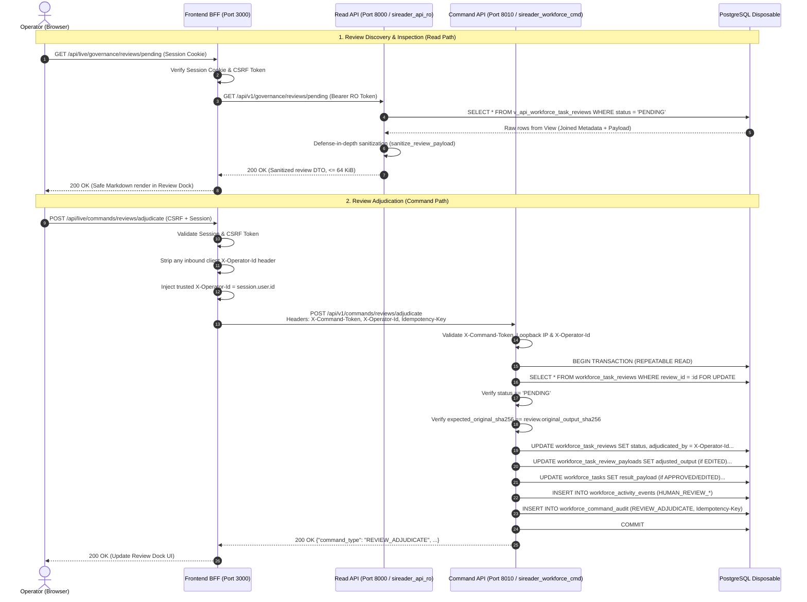

# SIREADER Phase 5.2.2 - Human Output Review Subsystem Architecture Proposal
**Subsystem:** Human Output Review, Quality Adjudication & Governance  
**Checkpoint:** 5.2.2-A (Architecture Proposal & Review Policy Specification)  
**Status:** PROPOSED FOR ARCHITECTURAL REVIEW (Revision 1.1.1 - Decoupled Payload Storage, Pre-Release Sanitization, 64 KiB Alignment & Atomic Worker Quarantine)  
**Target Branches:** `phase-5-implementation` (SIREADER & SIREADER-Python-Backend)  
**Security Level:** Air-Gapped Local Disposable Staging (Strictly Zero LIVE Supabase / Paid Provider Exposure)  
**Lead Reviewer:** ChatGPT (Architecture & Review)  
**Pair Programmer:** Antigravity (Implementation & Acceptance)  
**Document Revision:** 1.1.1  

---

## 1. Executive Summary & Design Vision

In Phase 5.2.1, we hardened the append-only activity ledger (`workforce_activity_events`), enforced sequential event ordering (`event_seq`), established tamper-proof database triggers rejecting mutations, implemented single direct retry lineage (`uq_workforce_tasks_related_task`), and delivered the audited timeline reconstruction endpoint (`GET /api/v1/workforce/tasks/{task_id}/timeline`).

Checkpoint 5.2.2 establishes the **Human Output Review Subsystem**. While Phase 4 enabled autonomous worker task execution, certain non-trading task outputs (e.g. strategic syntheses, complex research reports, data summaries, policy evaluations) require human operator verification or editorial adjustment before downstream release or final consumption.

### Key Architectural Invariants in Revision 1.1.1:
1. **Decoupled Governance Metadata vs. Payload Storage:** To reconcile terminal immutability with time-based data retention, review metadata (`workforce_task_reviews`) is strictly separated from review payload storage (`workforce_task_review_payloads`). When retention purging runs, payload contents are purged (`payload_purged_at`) without modifying terminal review records or violating immutability triggers.
2. **Pre-Persistence & Pre-Release Sanitization:** Worker outputs are recursively scrubbed for credentials and sensitive patterns *before* being written to review storage and *before* computing canonical SHA-256 hashes. Released outputs (`APPROVED` or `EDITED`) copy only pre-sanitized payloads into `workforce_tasks.result_payload`. Read API provides a defense-in-depth second sanitization layer.
3. **64 KiB Runtime Contract Alignment:** Review payload size limits are strictly aligned with existing worker contracts (`MAX_PAYLOAD_BYTES = 64 * 1024` in `app/workers/repository.py`).
4. **Atomic Worker Completion & Output Quarantine:** Task completion, review queue insertion, and `HUMAN_REVIEW_QUEUED` event emission are executed inside a single atomic database transaction in `complete_task()`. Unapproved output is never transiently visible in `workforce_tasks.result_payload`.
5. **Backend-Owned Versioned Policy Module (`app/governance/review_policy.py`):** Review eligibility is evaluated against authoritative `(capability, task_type)` catalog mappings with deterministic sampling. Client-supplied flags (e.g. `requires_human_review`) and nonexistent `task.policy_tags` are ignored.
6. **Strict Tripartite Lifecycle Separation:** Worker execution success (`COMPLETED`), provider network uncertainty (`WAITING_REVIEW`), and human quality adjudication (`workforce_task_reviews`) are decoupled into three distinct, non-overlapping lifecycles.
7. **Rejection Independence:** Editorial rejection of output leaves task status `COMPLETED` and review status `REJECTED`, with `result_payload = NULL`. It never overloads Phase 5.1 technical retry (`TASK_RETRY`).
8. **Trusted Operator Identity & Spoofing Defense:** BFF strips any inbound `X-Operator-Id` from client browsers, injecting verified identity from the server session. Command API (port 8010) strictly enforces the presence of internal identity headers.
9. **Referential Integrity & Audit Permanence:** Foreign keys use `ON DELETE RESTRICT` so review governance history cannot be deleted by upstream cascade deletions.
10. **Additive Audit Integration:** Extends `workforce_command_audit` command type constraint with `REVIEW_ADJUDICATE` and integrates `HUMAN_REVIEW_*` events into `ActivityEventType`.

---

## 2. Hard Boundaries & Invariants

All designs and implementations within Checkpoint 5.2.2 strictly adhere to the following invariants:
1. **Zero Supabase LIVE Interaction:** Target exclusively the local disposable PostgreSQL instance (`127.0.0.1:5432`). Supabase LIVE (`otinrvvfjnyxjvzcmdia`) remains completely untouched.
2. **Zero Paid Provider Invocations:** All automated tests and verifications use mock/simulated fixtures. Real LLM APIs remain completely dormant.
3. **Strict Trading Boundary Decoupling:** Non-trading output review is entirely independent of MT5/HFM trading bridges, order placement, position sizing, SL/TP rules, and trading risk approvals (`approval_decisions`).
4. **Zero Main Branch Commits:** All changes remain isolated on branch `phase-5-implementation`.
5. **Zero Secret Leakage:** No bearer tokens, passwords, database credentials, or unsanitized payloads are logged or exposed to the client.
6. **No Speculative Implementation Code in 5.2.2-A:** This document constitutes the design and review policy contract. Implementation code begins only after ChatGPT review and signoff.

---

## 3. Review Policy & Eligibility Specification

### 3.1. Non-Trading Scope & Hard Trading Ban
The review subsystem strictly processes **non-trading operational artifacts**. Under no circumstances can a trading order, position management request, broker command, or financial risk decision be submitted to or adjudicated by `workforce_task_reviews`. Trading approvals continue to be governed exclusively by the dedicated `approval_decisions` table and MT5 risk engine.

### 3.2. Authoritative Capability & Task Type Allowlist
Eligibility for human output review is determined exclusively by backend policy logic. A task is eligible for human review if and only if its `(required_capability, task_type)` tuple matches an authorized entry in the backend's authoritative catalog (`app/workers/registry.py`):

| Required Capability | Authoritative Task Types | Review Trigger Mode | Default Rationale |
| :--- | :--- | :--- | :--- |
| `quick_research` | `QUICK_RESEARCH`, `RESEARCH` | `SAMPLE` (20%) | Fast research synthesis; spot-checked for factual consistency. |
| `information_extraction` | `INFORMATION_EXTRACTION`, `CLASSIFICATION` | `SAMPLE` (10%) | Entity extraction; reviewed when source document confidence is low. |
| `summarization` | `SUMMARIZATION`, `CLASSIFICATION` | `SAMPLE` (15%) | Executive summaries; spot-checked before distribution. |
| `data_analysis` | `DATA_ANALYSIS`, `REASONING` | `SAMPLE` (25%) | Quantitative analysis; audited for methodology integrity. |
| `comparison` | `COMPARISON`, `REASONING` | `SAMPLE` (20%) | Multi-criteria evaluations; checked against decision rubrics. |
| `evaluation` | `EVALUATION`, `REASONING` | `MANDATORY` | Artifact checklists; verified by human reviewer. |
| `structured_reasoning` | `STRUCTURED_REASONING`, `REASONING` | `SAMPLE` (30%) | Multi-step reasoning chains; validated for premise validity. |
| `complex_reasoning` | `COMPLEX_REASONING`, `ESCALATION` | `MANDATORY` | High-complexity escalations (Opus tier); requires signoff. |
| `strategic_analysis` | `STRATEGIC_ANALYSIS`, `ESCALATION` | `MANDATORY` | Strategic roadmap recommendations; requires signoff. |
| `deep_review` | `DEEP_REVIEW`, `ESCALATION` | `MANDATORY` | In-depth architectural/procedural audits; requires signoff. |
| `data_archiving` | `DATA_ARCHIVING`, `ARCHIVAL` | `NONE` | State archival records; standard automated validation. |

*Any task type or capability not explicitly enumerated in the backend catalog is strictly barred from entering the review subsystem.*

### 3.3. Backend Policy Module (`app/governance/review_policy.py`)
To avoid modifying existing contracts (`CapabilityContract` or `WorkTaskRecord`), review policies are encapsulated in a versioned backend module:

```python
POLICY_VERSION = "2026.11.01"

class ReviewTriggerMode(str, Enum):
    MANDATORY = "MANDATORY"
    SAMPLE = "SAMPLE"
    NONE = "NONE"

@dataclass(frozen=True)
class CapabilityReviewRule:
    mode: ReviewTriggerMode
    sample_rate_percent: int = 0
    sample_salt: str = "sireader_governance_v1"

REVIEW_POLICY_CATALOG: dict[tuple[str, str], CapabilityReviewRule] = {
    ("quick_research", "QUICK_RESEARCH"): CapabilityReviewRule(ReviewTriggerMode.SAMPLE, 20),
    ("quick_research", "RESEARCH"): CapabilityReviewRule(ReviewTriggerMode.SAMPLE, 20),
    ("evaluation", "EVALUATION"): CapabilityReviewRule(ReviewTriggerMode.MANDATORY),
    ("evaluation", "REASONING"): CapabilityReviewRule(ReviewTriggerMode.MANDATORY),
    ("complex_reasoning", "COMPLEX_REASONING"): CapabilityReviewRule(ReviewTriggerMode.MANDATORY),
    ("complex_reasoning", "ESCALATION"): CapabilityReviewRule(ReviewTriggerMode.MANDATORY),
    ("strategic_analysis", "STRATEGIC_ANALYSIS"): CapabilityReviewRule(ReviewTriggerMode.MANDATORY),
    ("strategic_analysis", "ESCALATION"): CapabilityReviewRule(ReviewTriggerMode.MANDATORY),
    ("deep_review", "DEEP_REVIEW"): CapabilityReviewRule(ReviewTriggerMode.MANDATORY),
    ("deep_review", "ESCALATION"): CapabilityReviewRule(ReviewTriggerMode.MANDATORY),
}

def evaluate_review_eligibility(capability_id: str, task_type: str, task_id: str) -> bool:
    """
    Evaluates whether a completed task requires human output review.
    Client-supplied flags are untrusted and completely ignored.
    """
    rule = REVIEW_POLICY_CATALOG.get((capability_id, task_type))
    if not rule or rule.mode == ReviewTriggerMode.NONE:
        return False
        
    if rule.mode == ReviewTriggerMode.MANDATORY:
        return True
        
    if rule.mode == ReviewTriggerMode.SAMPLE:
        # Deterministic hash-based sampling reproducible across audit runs
        seed = f"{POLICY_VERSION}:{task_id}:{rule.sample_salt}"
        bucket = int(hashlib.sha256(seed.encode("utf-8")).hexdigest(), 16) % 100
        return bucket < rule.sample_rate_percent
        
    return False
```

---

## 4. Lifecycle Architecture & Decoupling

### 4.1. The Three Distinct System Lifecycles

```
┌─────────────────────────────────────────────────────────────────────────────┐
│ 1. Task Execution Lifecycle (workforce_tasks.status)                        │
│    QUEUED ──► CLAIMED ──► RUNNING ──► COMPLETED (or FAILED / CANCELLED)     │
└─────────────────────────────────────────────────────────────────────────────┘
                                      │
          If execution succeeded and evaluate_review_eligibility == True:
                                      ▼
┌─────────────────────────────────────────────────────────────────────────────┐
│ 2. Human Output Review Lifecycle (workforce_task_reviews.status)            │
│    PENDING ──► APPROVED (releases sanitized original_output)                │
│             ──► EDITED   (releases sanitized adjusted_output)                │
│             ──► REJECTED (output quarantined; result_payload remains NULL)   │
│             ──► EXPIRED  (timed out; output quarantined; audit recorded)    │
└─────────────────────────────────────────────────────────────────────────────┘

┌─────────────────────────────────────────────────────────────────────────────┐
│ 3. Provider Uncertainty Lifecycle (Existing Phase 4 WAITING_REVIEW)         │
│    Provider HTTP 504 / Network Drop ──► Cost Guard Quarantine               │
│    (STRICTLY UNRELATED TO HUMAN OUTPUT REVIEW)                              │
└─────────────────────────────────────────────────────────────────────────────┘
```

### 4.2. Atomic Worker Completion & Output Quarantine

Worker completion modifies `complete_task()` in `app/workers/repository.py` to ensure transactional atomicity:

```
BEGIN TRANSACTION (REPEATABLE READ)
  1. Validate payload size <= MAX_PAYLOAD_BYTES (64 KiB).
  2. Mark workforce_task_attempts status = 'COMPLETED'.
  3. Evaluate evaluate_review_eligibility(task.required_capability, task.task_type, task.task_id).
  4. If requires_review == True:
       a. Sanitize raw attempt payload -> sanitized_output.
       b. Compute canonical original_output_sha256 = SHA256(canonical_json(sanitized_output)).
       c. Set workforce_tasks.status = 'COMPLETED'.
       d. Set workforce_tasks.result_payload = NULL (gated output quarantine).
       e. Insert into workforce_task_reviews (status = 'PENDING', original_output_sha256).
       f. Insert into workforce_task_review_payloads (original_output = sanitized_output).
       g. Insert into workforce_activity_events (HUMAN_REVIEW_QUEUED, {review_id, original_output_sha256}).
  5. If requires_review == False:
       a. Set workforce_tasks.status = 'COMPLETED'.
       b. Set workforce_tasks.result_payload = attempt_output.
COMMIT
```
*Guarantees: Zero transient window where unapproved output is readable; atomic review creation.*

### 4.3. Adjudication Release Semantics

1. **On `APPROVED`:**
   - Read `original_output` from `workforce_task_review_payloads`.
   - Update `workforce_tasks.result_payload = original_output`.
   - Update `workforce_task_reviews.status = 'APPROVED'`, `adjudicated_by = X-Operator-Id`, `adjudicated_at = NOW()`.
   - Emit `HUMAN_REVIEW_APPROVED` to activity ledger.
2. **On `EDITED`:**
   - Validate `adjusted_output` size <= 64 KiB.
   - Sanitize `adjusted_output` -> `sanitized_adjusted_output`.
   - Compute `adjusted_output_sha256 = SHA256(canonical_json(sanitized_adjusted_output))`.
   - Update `workforce_task_review_payloads.adjusted_output = sanitized_adjusted_output`.
   - Update `workforce_tasks.result_payload = sanitized_adjusted_output`.
   - Update `workforce_task_reviews.status = 'EDITED'`, `adjusted_output_sha256`, `adjudicated_by`, `adjudicated_at`.
   - Emit `HUMAN_REVIEW_EDITED` to activity ledger.
3. **On `REJECTED`:**
   - `workforce_tasks.result_payload` remains `NULL`.
   - Update `workforce_task_reviews.status = 'REJECTED'`, `reason_code = request.reason_code`, `notes = request.notes`, `adjudicated_by`, `adjudicated_at`.
   - Emit `HUMAN_REVIEW_REJECTED` to activity ledger (reason code only, notes excluded).
4. **On `EXPIRED`:**
   - Background sweeper marks `workforce_task_reviews.status = 'EXPIRED'`, `adjudicated_by = 'system'`, `reason_code = 'REVIEW_TIMED_OUT'`.
   - `workforce_tasks.result_payload` remains `NULL`.
   - Emit `HUMAN_REVIEW_EXPIRED` to activity ledger.

### 4.4. Rejection Independence from Technical Retry
A human output rejection indicates an editorial decision that the content generated by the LLM was inadequate or unsuitable. It is **not a technical execution failure**:
- The worker succeeded and token costs were incurred legitimately.
- Phase 5.1 `TASK_RETRY` (`retry_failed_non_trading_task`) requires `status == 'FAILED'` and is blocked by 409 Conflict.
- For Checkpoint 5.2.2, a rejected task remains `COMPLETED` with `result_payload = NULL`.
- If an operator wishes to re-run the request, it must be submitted as a brand-new `TASK_ENQUEUE` with a fresh correlation ID.

---

## 5. End-to-End Authorization & Data-Flow



---

## 6. Data Model & Storage Lifecycle

### 6.1. Decoupled Database Schemas

To permanently resolve the contradiction between terminal immutability and time-based retention purging, data is split into metadata and payload tables:

```sql
-- 1. Governance Metadata Table (Permanent, Immutable once terminal)
CREATE TABLE IF NOT EXISTS public.workforce_task_reviews (
    review_id VARCHAR(64) PRIMARY KEY,
    task_id VARCHAR(64) NOT NULL REFERENCES public.workforce_tasks(task_id) ON DELETE RESTRICT,
    attempt_id VARCHAR(64) NOT NULL REFERENCES public.workforce_task_attempts(attempt_id) ON DELETE RESTRICT,
    status VARCHAR(24) NOT NULL DEFAULT 'PENDING',
    original_output_sha256 CHAR(64) NOT NULL,
    adjusted_output_sha256 CHAR(64),
    adjudicated_by VARCHAR(100),
    adjudicated_at TIMESTAMPTZ,
    reason_code VARCHAR(48),
    notes VARCHAR(500),
    review_expires_at TIMESTAMPTZ NOT NULL,
    created_at TIMESTAMPTZ NOT NULL DEFAULT NOW(),
    updated_at TIMESTAMPTZ NOT NULL DEFAULT NOW(),

    CONSTRAINT uq_workforce_task_reviews_task UNIQUE (task_id),
    CONSTRAINT ck_workforce_task_reviews_status CHECK (
        status IN ('PENDING', 'APPROVED', 'EDITED', 'REJECTED', 'EXPIRED')
    ),
    CONSTRAINT ck_workforce_task_reviews_sha256_format CHECK (
        original_output_sha256 ~ '^[0-9a-f]{64}$' AND
        (adjusted_output_sha256 IS NULL OR adjusted_output_sha256 ~ '^[0-9a-f]{64}$')
    ),
    CONSTRAINT ck_workforce_task_reviews_adjudication CHECK (
        (status = 'PENDING' AND adjudicated_at IS NULL AND adjudicated_by IS NULL) OR
        (status = 'EXPIRED' AND adjudicated_at IS NOT NULL AND adjudicated_by = 'system' AND reason_code = 'REVIEW_TIMED_OUT') OR
        (status IN ('APPROVED', 'EDITED', 'REJECTED') AND adjudicated_at IS NOT NULL AND adjudicated_by IS NOT NULL)
    ),
    CONSTRAINT ck_workforce_task_reviews_edited CHECK (
        (status = 'EDITED' AND adjusted_output_sha256 IS NOT NULL) OR
        (status != 'EDITED' AND adjusted_output_sha256 IS NULL)
    ),
    CONSTRAINT ck_workforce_task_reviews_rejected CHECK (
        (status = 'REJECTED' AND reason_code IS NOT NULL) OR
        (status != 'REJECTED' AND (status != 'EXPIRED' OR reason_code = 'REVIEW_TIMED_OUT'))
    )
);

CREATE INDEX IF NOT EXISTS ix_workforce_task_reviews_status_created 
    ON public.workforce_task_reviews (status, created_at DESC);
CREATE INDEX IF NOT EXISTS ix_workforce_task_reviews_expires 
    ON public.workforce_task_reviews (review_expires_at) WHERE status = 'PENDING';

-- 2. Review Payloads Table (Subject to retention purging, max 64 KiB)
CREATE TABLE IF NOT EXISTS public.workforce_task_review_payloads (
    review_id VARCHAR(64) PRIMARY KEY REFERENCES public.workforce_task_reviews(review_id) ON DELETE RESTRICT,
    original_output JSONB,
    adjusted_output JSONB,
    payload_purged_at TIMESTAMPTZ,
    created_at TIMESTAMPTZ NOT NULL DEFAULT NOW(),
    updated_at TIMESTAMPTZ NOT NULL DEFAULT NOW(),

    CONSTRAINT ck_workforce_review_payloads_size CHECK (
        (original_output IS NULL OR pg_column_size(original_output) <= 65536) AND
        (adjusted_output IS NULL OR pg_column_size(adjusted_output) <= 65536)
    ),
    CONSTRAINT ck_workforce_review_payloads_purged CHECK (
        (payload_purged_at IS NULL AND original_output IS NOT NULL) OR
        (payload_purged_at IS NOT NULL AND original_output IS NULL AND adjusted_output IS NULL)
    )
);
```

### 6.2. Immutability & Anti-Mutation Triggers

```sql
CREATE OR REPLACE FUNCTION public.sireader_guard_review_metadata_v1()
RETURNS TRIGGER AS $$
BEGIN
    -- SHA256 hashes and identity references are strictly immutable
    IF OLD.original_output_sha256 IS DISTINCT FROM NEW.original_output_sha256 OR
       OLD.task_id IS DISTINCT FROM NEW.task_id OR
       OLD.attempt_id IS DISTINCT FROM NEW.attempt_id THEN
        RAISE EXCEPTION 'Core governance references and original hash are immutable.';
    END IF;

    -- Reject modifications to terminal reviews
    IF OLD.status IN ('APPROVED', 'EDITED', 'REJECTED', 'EXPIRED') THEN
        RAISE EXCEPTION 'Terminal review state % cannot be modified.', OLD.status;
    END IF;

    NEW.updated_at = NOW();
    RETURN NEW;
END;
$$ LANGUAGE plpgsql;

CREATE TRIGGER trg_workforce_task_reviews_guard
BEFORE UPDATE ON public.workforce_task_reviews
FOR EACH ROW EXECUTE FUNCTION public.sireader_guard_review_metadata_v1();
```

### 6.3. Retention & Expiration Policy

1. **Pending Review Shield:** The Phase 4 retention job `purge_expired_task_payloads()` includes a strict guard:
   ```sql
   WHERE NOT EXISTS (
       SELECT 1 FROM public.workforce_task_reviews r
       WHERE r.task_id = t.task_id AND r.status = 'PENDING'
   )
   ```
2. **Review Expiration Job:** A background worker inspects:
   ```sql
   UPDATE public.workforce_task_reviews
   SET status = 'EXPIRED',
       adjudicated_by = 'system',
       reason_code = 'REVIEW_TIMED_OUT',
       adjudicated_at = NOW(),
       updated_at = NOW()
   WHERE status = 'PENDING' AND review_expires_at < NOW();
   ```
3. **Payload-Only Terminal Retention Purging:** Once a review is terminal (`APPROVED`, `EDITED`, `REJECTED`, `EXPIRED`) and the parent task's `payload_expires_at` has elapsed:
   ```sql
   UPDATE public.workforce_task_review_payloads p
   SET original_output = NULL,
       adjusted_output = NULL,
       payload_purged_at = NOW(),
       updated_at = NOW()
   FROM public.workforce_task_reviews r
   JOIN public.workforce_tasks t ON t.task_id = r.task_id
   WHERE p.review_id = r.review_id
     AND r.status IN ('APPROVED', 'EDITED', 'REJECTED', 'EXPIRED')
     AND p.payload_purged_at IS NULL
     AND t.payload_expires_at < NOW();
   ```
   *Crucial Advantage:* Purging only modifies `workforce_task_review_payloads`. `workforce_task_reviews` remains untouched and 100% compliant with its terminal immutability trigger!

### 6.4. Mandatory Implementation Guardrails (Checkpoint 5.2.2-B Alignment)

1. **Payload Storage Immutability & Anti-Resurrection Trigger (`sireader_guard_review_payloads_v1`):**
   - `original_output` is strictly immutable after initial insert.
   - `adjusted_output` is write-once (transitions only from `NULL` to non-`NULL` on valid adjudication).
   - Once `payload_purged_at` is set by the retention sweeper, the payload cannot be modified or restored (`anti-resurrection`).
   - Purging is permitted only when the associated review record in `workforce_task_reviews` is in a terminal status (`APPROVED`, `EDITED`, `REJECTED`, `EXPIRED`) and the task's retention period has elapsed.
   - Purging sets `original_output = NULL` and `adjusted_output = NULL` while preserving `workforce_task_reviews` metadata and SHA-256 hashes permanently.

2. **Exhaustive Review Policy Mapping:**
   - The versioned backend policy catalog (`app/governance/review_policy.py`) must contain explicit mappings for every capability in `CAPABILITY_CATALOG` (`app/workers/registry.py`) across all authorized task types.
   - Any capability or task type not in the catalog fails closed (`NONE`).
   - All trading-adjacent roles (Decision Engineer, Market Monitor) are explicitly barred from entering the review subsystem.

---

## 7. Security, Sanitization & Read API

### 7.1. Layered Defense Architecture

| Layer | Responsibility | Mechanism |
| :--- | :--- | :--- |
| **1. Ingest Sanitization** | Scrub credentials *before* storage and hash computation. | `sanitize_review_payload()` parses dict/lists and scrubs patterns to `[REDACTED]`. |
| **2. Database Role Boundary** | Deny base table access to API roles. | `REVOKE ALL ON public.workforce_task_reviews, public.workforce_task_review_payloads FROM public, sireader_api_ro;` |
| **3. Security-Barrier View** | Encapsulate row join under security barrier. | View `v_api_workforce_task_reviews` joins metadata with unpurged payload. |
| **4. Defense-in-Depth Read Scrubbing** | Secondary scrub on Read API endpoint. | Second pass through `sanitize_review_payload()` before serialization. |
| **5. Transport Boundary (BFF)** | Strip untrusted headers; loopback proxy. | BFF strips client `X-Operator-Id`, injects verified session operator. |
| **6. Safe UI Markdown** | Zero XSS / script injection in browser. | `rehype-sanitize` with restricted element allowlist (no script, iframe, or raw HTML). |

### 7.2. Backend Application Sanitizer & Test Corpus (`app/ai/sanitizer.py`)
Scrubber redacts keys matching: `token`, `secret`, `password`, `key`, `authorization`, `cookie`, `credential`, `connection_string`.
Regex values scrubbed:
- Bearer tokens: `(?i)Bearer\s+[A-Za-z0-9\-_\.=]+`
- Database URLs: `(?i)postgres(ql)?:\/\/[^@\s]+@[^\s]+`
- Generic API keys: `(?i)(AIza|sk-[a-zA-Z0-9]{20,}|ghp_[a-zA-Z0-9]{20,})`

**Verification Test Corpus:** Includes positive/negative test cases covering nested dicts, lists, embedded strings, multiline markdown, and false-positive boundaries.

### 7.3. Read API Endpoints (Port 8000)
- `GET /api/v1/governance/reviews/pending?limit=20&offset=0`
- `GET /api/v1/governance/reviews/{review_id}`
- Accessible exclusively by role `sireader_api_ro` via view `v_api_workforce_task_reviews`.

---

## 8. Command API & Trusted Operator Adjudication

### 8.1. Command Specification (Port 8010)
- Endpoint: `POST /api/v1/commands/reviews/adjudicate`
- Bound strictly to `127.0.0.1:8010`.
- Required Headers:
  - `X-Command-Token`: matches `SIREADER_WORKFORCE_COMMAND_TOKEN`.
  - `X-Operator-Id`: authenticated operator username/ID passed by BFF.
  - `Idempotency-Key`: UUID v4 for anti-replay.

### 8.2. Request Contract

```python
class ReviewAdjudicationDecision(str, Enum):
    APPROVE = "APPROVE"
    EDIT = "EDIT"
    REJECT = "REJECT"

class ReviewAdjudicationRequest(BaseModel):
    model_config = ConfigDict(extra="forbid")
    
    review_id: str = Field(..., min_length=1, max_length=64)
    decision: ReviewAdjudicationDecision
    expected_original_sha256: str = Field(..., min_length=64, max_length=64)
    adjusted_output: dict[str, Any] | None = None
    reason_code: str | None = Field(None, max_length=48)
    notes: str | None = Field(None, max_length=500)

    @model_validator(mode="after")
    def validate_semantics(self) -> Self:
        if self.decision == ReviewAdjudicationDecision.EDIT:
            if not self.adjusted_output:
                raise ValueError("adjusted_output is required when decision is EDIT")
        if self.decision == ReviewAdjudicationDecision.REJECT:
            if not self.reason_code or not self.reason_code.strip():
                raise ValueError("reason_code is required when decision is REJECT")
        return self
```

### 8.3. Additive Command Audit Constraint
An additive migration alters `workforce_command_audit`:
```sql
ALTER TABLE public.workforce_command_audit 
DROP CONSTRAINT IF EXISTS ck_workforce_command_audit_type;

ALTER TABLE public.workforce_command_audit 
ADD CONSTRAINT ck_workforce_command_audit_type CHECK (
    command_type IN ('TASK_ENQUEUE', 'TASK_CANCEL', 'TASK_RETRY', 'WORKER_SCHEDULING_SET', 'REVIEW_ADJUDICATE')
);
```

---

## 9. Append-Only Audit Event Ledger

New event types added to `ActivityEventType` in `app/workers/runtime_contract.py`:
- `HUMAN_REVIEW_QUEUED`
- `HUMAN_REVIEW_APPROVED`
- `HUMAN_REVIEW_EDITED`
- `HUMAN_REVIEW_REJECTED`
- `HUMAN_REVIEW_EXPIRED`

| Event Type | Actor Type | Actor ID Source | Event Payload Contents |
| :--- | :--- | :--- | :--- |
| `HUMAN_REVIEW_QUEUED` | `SYSTEM` | `system` | `{"review_id": "...", "original_sha256": "..."}` |
| `HUMAN_REVIEW_APPROVED` | `OPERATOR` | `X-Operator-Id` | `{"review_id": "...", "original_sha256": "..."}` |
| `HUMAN_REVIEW_EDITED` | `OPERATOR` | `X-Operator-Id` | `{"review_id": "...", "original_sha256": "...", "adjusted_sha256": "..."}` |
| `HUMAN_REVIEW_REJECTED` | `OPERATOR` | `X-Operator-Id` | `{"review_id": "...", "reason_code": "..."}` |
| `HUMAN_REVIEW_EXPIRED` | `SYSTEM` | `system` | `{"review_id": "...", "original_sha256": "...", "reason_code": "REVIEW_TIMED_OUT"}` |

*Audit payloads contain cryptographic hashes and structured reason codes only. Raw outputs and free-form notes are strictly excluded from activity events to maintain audit ledger privacy.*

---

## 10. Comprehensive 18-Scenario Test Matrix

| # | Layer | Test Scenario | Expected Outcome |
| :--- | :--- | :--- | :--- |
| 1 | **Atomic Completion** | Worker completes eligible task (`requires_review = True`). | Task marked `COMPLETED`; `result_payload` is `NULL`; review created `PENDING` with sanitized output in single transaction. |
| 2 | **Quarantine** | Query task result while review is `PENDING`. | `result_payload` remains `NULL`; unapproved output is strictly quarantined. |
| 3 | **Adjudication (Approve)** | Operator approves review (`APPROVE`). | Review marked `APPROVED`; `result_payload` populated with pre-sanitized `original_output`. |
| 4 | **Adjudication (Edit)** | Operator submits valid `adjusted_output` (`EDIT`). | `adjusted_output` sanitized and stored; review marked `EDITED`; `result_payload` populated with adjusted output. |
| 5 | **Adjudication (Reject)** | Operator rejects review (`REJECT`). | Review marked `REJECTED`; `result_payload` remains `NULL`; task stays `COMPLETED`. |
| 6 | **Payload Cap (64 KiB)** | Attempt to submit `original_output` or `adjusted_output` > 64 KiB. | Rejected with 422 Unprocessable Entity / check constraint violation. |
| 7 | **Pre-Sanitization** | Worker output contains Bearer token / DB URL. | Scrubbed to `[REDACTED]` *before* storage and before SHA256 computation; approved release contains sanitized payload. |
| 8 | **Retention Shield** | Retention sweeper runs while review is `PENDING`. | Pending review payload is shielded and NOT purged. |
| 9 | **Decoupled Purge** | Retention sweeper runs for terminal review after expiration. | `workforce_task_review_payloads` nulled with `payload_purged_at`; `workforce_task_reviews` metadata remains intact without immutability trigger violation. |
| 10 | **Expiration Sweeper** | Review exceeds `review_expires_at` without adjudication. | Background sweeper marks review `EXPIRED`, `reason_code = 'REVIEW_TIMED_OUT'`, emits `HUMAN_REVIEW_EXPIRED`. |
| 11 | **Concurrency Lock** | Two concurrent adjudication requests on identical `review_id`. | Row-level lock (`FOR UPDATE`) allows one to succeed; second receives `409 REVIEW_ALREADY_ADJUDICATED`. |
| 12 | **Idempotency Replay** | Replay adjudication request with identical `Idempotency-Key` and payload. | Returns 200 OK with cached response; zero duplicate events emitted. |
| 13 | **Idempotency Conflict** | Replay adjudication request with identical key but different decision/payload. | Rejection with `409 IDEMPOTENCY_KEY_REUSE_PAYLOAD_MISMATCH`. |
| 14 | **Hash Stale Snapshot** | Adjudication submitted with mismatched `expected_original_sha256`. | Rejection with `409 STALE_REVIEW_SNAPSHOT`. |
| 15 | **Header Spoofing** | Client sends forged `X-Operator-Id` in request header to BFF. | BFF strips client header; injects verified session identity. |
| 16 | **Body Identity Ignore** | Client attempts to send forged `adjudicated_by` in request body. | Body field ignored; Command API takes identity strictly from trusted header. |
| 17 | **Command Audit & Enum** | Execute adjudication command and verify audit logging. | `REVIEW_ADJUDICATE` written to `workforce_command_audit`; `HUMAN_REVIEW_*` verified in `workforce_activity_events`. |
| 18 | **Referential Integrity** | Direct attempt to delete `workforce_tasks` record referenced by review. | Rejected by `ON DELETE RESTRICT` constraint. |

---

## 11. Sub-unit Implementation Roadmap (Phase 5 Accelerated Execution)

```
[5.2.2-A] Architecture & Policy Proposal (Rev 1.1.1 - THIS DOCUMENT)
   │
   ▼ (Upon Signoff)
[5.2.2-B] Database Schema & Backend Review Repository
   │  - Migration adding workforce_task_reviews, workforce_task_review_payloads, view & command audit constraint
   │  - Review policy module app/governance/review_policy.py & sanitizer app/ai/sanitizer.py
   │  - Atomic worker completion update in complete_task()
   │  - Unit tests covering scenarios 1, 2, 6, 7, 8, 9, 10, 18
   │
   ▼
[5.2.2-C] Adjudication Command API (Port 8010)
   │  - POST /api/v1/commands/reviews/adjudicate with FOR UPDATE locking & idempotency
   │  - Concurrency, idempotency & trusted actor tests (scenarios 3, 4, 5, 11, 12, 13, 14, 16, 17)
   │
   ▼
[5.2.2-D] Governance Read API & Secure BFF Proxy (Port 8000 & 3000)
   │  - GET /api/v1/governance/reviews/pending and GET /{id} via role sireader_api_ro
   │  - BFF loopback proxy, CSRF validation & operator header stripping/injection (scenario 15)
   │
   ▼
[5.2.2-E] Review Inbox UI (Virtual Office Dock)
   │  - Safe Markdown renderer component (rehype-sanitize)
   │  - LIVE Review Dock panel with side-by-side diff inspector
   │  - DEMO mode isolation & logout memory purge
   │
   ▼ (Seamlessly proceeding directly to next Phase 5 sub-phases without manual checkpoint pauses)
[5.2.3] Budget Governance & Cost Guard Integration (Observability endpoint & UI)
   │
   ▼
[5.2.4] Model Escalation & Sensitive Task Policy (Deterministic tier routing & hard reject)
   │
   ▼
[5.2.5] Ops Finalization & Comprehensive Phase 5 Acceptance Testing
      - Full regression test suite
      - Single unified browser acceptance testing across all Phase 5 capabilities
```

---

## 12. Verification Checklist for Revision 1.1.1

- [x] Review metadata decoupled from review payloads (`workforce_task_reviews` vs `workforce_task_review_payloads`).
- [x] Immutability trigger preserved on terminal metadata while allowing time-based retention purging on payloads.
- [x] Worker output sanitized *before* storage and *before* computing canonical SHA-256 hash.
- [x] Pre-sanitized payload released to `result_payload` on `APPROVED` or `EDITED`.
- [x] Review payload size cap strictly aligned with worker runtime contract at 64 KiB (`65536` bytes).
- [x] Review policy cleanly encapsulated in separate versioned module `app/governance/review_policy.py` without modifying existing contracts.
- [x] Untrusted client flags and nonexistent `task.policy_tags` completely ignored.
- [x] Atomic worker completion defined in `complete_task()` preventing transient exposure.
- [x] Additive migration specified for `REVIEW_ADJUDICATE` in `workforce_command_audit`.
- [x] `HUMAN_REVIEW_*` events integrated into `ActivityEventType`.
- [x] BFF header spoofing defense specified (strips client `X-Operator-Id`).
- [x] Expanded 18-scenario test matrix documented.
- [x] Strictly zero implementation code written prior to architectural signoff.
