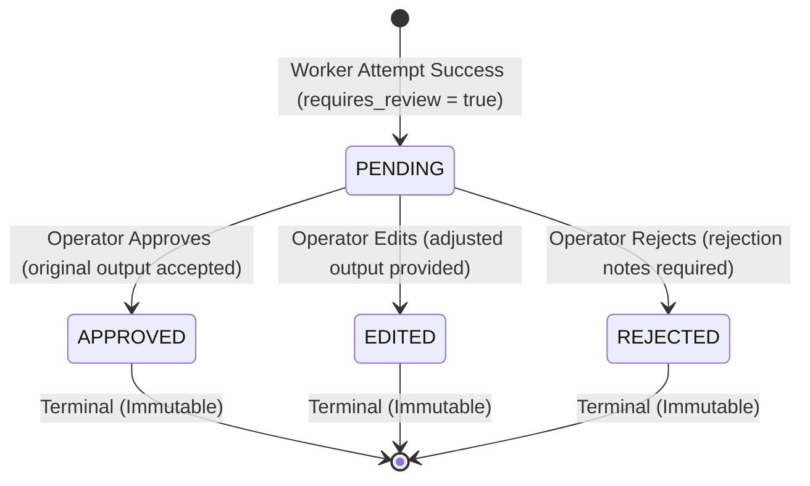
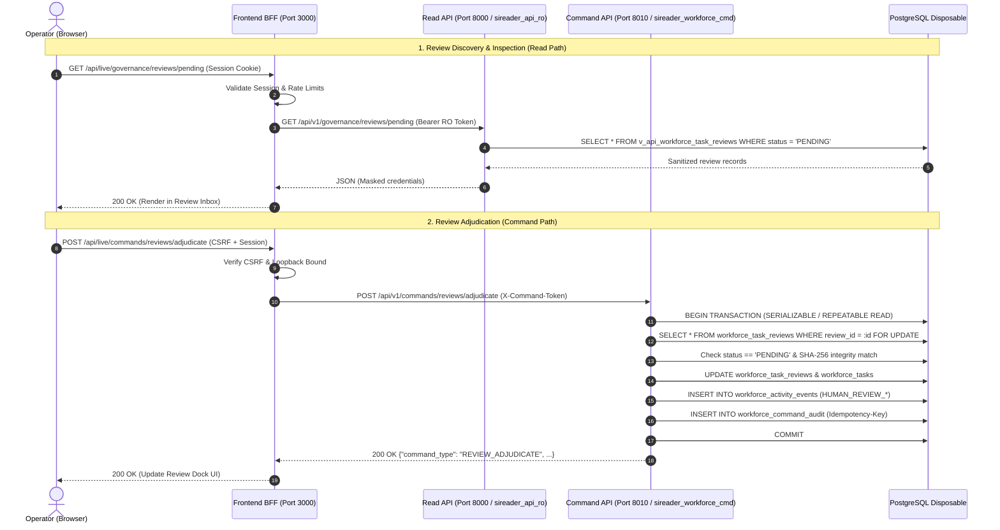

# SIREADER Phase 5.2.2 - Human Output Review Subsystem Architecture Proposal
**Subsystem:** Human Output Review, Quality Adjudication & Governance  
**Checkpoint:** 5.2.2-A (Architecture Proposal & Review Policy Specification)  
**Status:** PROPOSED FOR ARCHITECTURAL REVIEW  
**Target Branches:** `phase-5-implementation` (SIREADER & SIREADER-Python-Backend)  
**Security Level:** Air-Gapped Local Disposable Staging (Strictly Zero LIVE Supabase / Paid Provider Exposure)  
**Lead Reviewer:** ChatGPT (Architecture & Review)  
**Pair Programmer:** Antigravity (Implementation & Acceptance)  
**Document Revision:** 1.0.0  

---

## 1. Executive Summary & Objectives

In Phase 5.2.1, we hardened the append-only activity ledger (`workforce_activity_events`), enforced strict sequential event ordering (`event_seq`), established tamper-proof database triggers rejecting mutations, implemented single direct retry lineage, and delivered the audited timeline reconstruction endpoint (`GET /api/v1/workforce/tasks/{task_id}/timeline`).

Checkpoint 5.2.2 establishes the **Human Output Review Subsystem**. While Phase 4 enabled autonomous worker task execution, certain non-trading task outputs (e.g. strategic syntheses, complex research reports, data summaries, policy evaluations) require human operator verification or editorial adjustment before downstream consumption or final archival.

The Human Output Review Subsystem provides:
1. **Deterministic Review Policy & Eligibility:** Backend-enforced eligibility matrix ensuring only non-trading tasks can enter the review queue.
2. **Dedicated Review State Machine:** Independent review lifecycle (`PENDING`, `APPROVED`, `EDITED`, `REJECTED`) strictly decoupled from operational task statuses and financial trading approvals.
3. **Cryptographically Fingerprinted Review Repository:** Storing original worker outputs alongside SHA-256 integrity hashes and optional operator adjustments.
4. **Append-Only Decision Audit Integration:** Recording all human review decisions as immutable events in `workforce_activity_events`.
5. **Secure Command Orchestration:** Adjudication command executed exclusively over loopback port 8010 with row locks and idempotency protection.
6. **Sanitized Read Observability:** Read-only governance endpoints on port 8000 backed by security-barrier views and sensitive field redaction.
7. **Safe Frontend Review Inbox:** Live-only Virtual Office dock panel featuring sanitized markdown rendering (zero script/iframe execution) and full simulation-mode isolation.

---

## 2. Strict Boundary Invariants

All designs and implementations within Checkpoint 5.2.2 strictly enforce:
1. **Zero Supabase LIVE Interaction:** Target exclusively the local disposable PostgreSQL instance (`127.0.0.1:5432`). Supabase LIVE (`otinrvvfjnyxjvzcmdia`) remains untouched.
2. **Zero Paid Provider Invocations:** All automated tests and verifications use mock/simulated fixtures. Real LLM APIs remain completely dormant.
3. **Strict Trading Boundary Decoupling:** Non-trading output review is entirely independent of MT5/HFM trading bridges, order placement, position sizing, SL/TP rules, and trading risk approvals (`approval_decisions`).
4. **Zero Main Branch Commits:** All changes remain isolated on branch `phase-5-implementation`.
5. **Zero Secret Leakage:** No bearer tokens, passwords, database credentials, or unsanitized payloads are logged or exposed to the client.
6. **No Speculative Implementation Code in 5.2.2-A:** This document constitutes the design and review policy contract. Implementation code begins only after ChatGPT review and signoff.

---

## 3. Review Policy & Eligibility Matrix

### 3.1. Non-Trading Scope & Hard Trading Ban
The review subsystem strictly processes **non-trading operational artifacts**. Under no circumstances can a trading order, position management request, broker command, or financial risk decision be submitted to or adjudicated by `workforce_task_reviews`. Trading approvals continue to be governed exclusively by the dedicated `approval_decisions` table and MT5 risk engine.

### 3.2. Capability & Task Type Allowlist
Eligibility for human output review is determined exclusively by backend policy logic. A task is eligible for human review if and only if its `task_type` belongs to the approved non-trading governance allowlist:

| Capability ID | Allowed Task Types | Review Trigger Mode | Default Rationale |
| :--- | :--- | :--- | :--- |
| `quick_research` | `QUICK_RESEARCH`, `RESEARCH` | Configurable / Sampled | Fast research synthesis; spot-checked for factual consistency. |
| `information_extraction` | `INFORMATION_EXTRACTION`, `CLASSIFICATION` | Policy-based | Entity extraction; reviewed when source document confidence is low. |
| `summarization` | `SUMMARIZATION`, `CLASSIFICATION` | Optional / On-demand | Executive summaries; reviewed prior to external distribution. |
| `data_analysis` | `DATA_ANALYSIS`, `REASONING` | Mandatory if Flagged | Quantitative analysis; audited for methodology integrity. |
| `comparison` | `COMPARISON`, `REASONING` | Policy-based | Multi-criteria evaluations; checked against decision rubrics. |
| `evaluation` | `EVALUATION`, `REASONING` | Mandatory | Artifact checklists; verified by human reviewer. |
| `structured_reasoning` | `STRUCTURED_REASONING`, `REASONING` | Policy-based | Multi-step reasoning chains; validated for premise validity. |
| `complex_reasoning` | `COMPLEX_REASONING`, `ESCALATION` | Mandatory | High-complexity escalations (Opus tier); requires signoff. |
| `strategic_analysis` | `STRATEGIC_ANALYSIS`, `ESCALATION` | Mandatory | Strategic roadmap recommendations; requires signoff. |
| `deep_review` | `DEEP_REVIEW`, `ESCALATION` | Mandatory | In-depth architectural/procedural audits; requires signoff. |
| `data_archiving` | `DATA_ARCHIVING`, `ARCHIVAL` | Policy-based | State archival records; spot-checked for schema compliance. |

*Any task type not explicitly enumerated in the backend allowlist is strictly barred from entering the review subsystem.*

### 3.3. Policy Determination Gate
Whether a specific task requires human review is evaluated at task execution completion:
```
requires_review = (
    task.task_type IN NON_TRADING_REVIEW_ALLOWLIST
    AND (
        task.requires_human_review == TRUE
        OR capability.default_review_policy == 'MANDATORY'
        OR (capability.default_review_policy == 'SAMPLE' AND random_sample_matched())
    )
)
```
- If `requires_review == FALSE`: The task transitions directly to `COMPLETED`, storing worker output in `workforce_tasks.result_payload`.
- If `requires_review == TRUE`: A record in `workforce_task_reviews` is inserted with status `PENDING`, and the task is held in `WAITING_REVIEW` until human adjudication.

---

## 4. Review State Machine & Decoupling

### 4.1. Review Lifecycle State Machine



### 4.2. State Transition Semantics

| Transition | Pre-conditions | State Changes | Post-conditions |
| :--- | :--- | :--- | :--- |
| **Enqueue Review** (`PENDING`) | Worker attempt finishes with `COMPLETED`; `requires_review == TRUE`. | Insert `workforce_task_reviews` (`status = 'PENDING'`). Set `workforce_tasks.status = 'WAITING_REVIEW'`. | Emits `HUMAN_REVIEW_QUEUED` event. Task output gated from downstream consumers. |
| **Approve** (`APPROVED`) | Review is `PENDING`; valid operator session; matching SHA-256 fingerprint. | Update `workforce_task_reviews`: `status = 'APPROVED'`, `adjudicated_at = NOW()`, `adjudicated_by = operator`. Update `workforce_tasks`: `status = 'COMPLETED'`, `result_payload = original_output`. | Emits `HUMAN_REVIEW_APPROVED` event. Task marked completed. Output unlocked. |
| **Edit & Approve** (`EDITED`) | Review is `PENDING`; valid operator session; matching SHA-256; non-empty `adjusted_output`. | Update `workforce_task_reviews`: `status = 'EDITED'`, `adjusted_output = payload`, `adjudicated_at = NOW()`, `adjudicated_by = operator`. Update `workforce_tasks`: `status = 'COMPLETED'`, `result_payload = adjusted_output`. | Emits `HUMAN_REVIEW_EDITED` event (storing diff/summary). Original and adjusted outputs preserved for audit. |
| **Reject** (`REJECTED`) | Review is `PENDING`; valid operator session; non-empty rejection `notes`. | Update `workforce_task_reviews`: `status = 'REJECTED'`, `notes = reason`, `adjudicated_at = NOW()`, `adjudicated_by = operator`. Update `workforce_tasks`: `status = 'FAILED'`, `failure_code = 'HUMAN_OUTPUT_REJECTED'`. | Emits `HUMAN_REVIEW_REJECTED` event. Task output discarded. Operator may trigger manual retry. |

### 4.3. Explicit Decoupling from Trading and Network Uncertainty
It is critical to distinguish between three concepts that share similar terminology:
1. **Trading Approval (`approval_decisions`):** Governs financial market order execution, position opening, lot sizing, and risk compliance. Strict financial domain.
2. **Task Ambiguous State (`WAITING_REVIEW` in Phase 4 / 5.1):** Triggered when an external LLM provider call experiences a network timeout (504/timeout) and the cost guard cannot confirm whether tokens were consumed. System infrastructure domain.
3. **Human Output Review (`workforce_task_reviews` in Phase 5.2.2):** An editorial and quality adjudication of a *successfully generated* non-trading output (text, report, analysis). Operational governance domain.

To prevent semantic confusion:
- `workforce_task_reviews` maintains its own dedicated `status` column (`PENDING`, `APPROVED`, `EDITED`, `REJECTED`).
- The task `workforce_tasks.status` transitions from `WAITING_REVIEW` to `COMPLETED` (on `APPROVED` or `EDITED`) or `FAILED` (on `REJECTED`).
- Adjudication never touches financial records, broker connections, or MT5 accounts.

---

## 5. Authorization & Data-Flow Architecture

### 5.1. End-to-End Governance Data-Flow



---

## 6. Data Model & Storage Lifecycle

### 5.1. Database Schema (`public.workforce_task_reviews`)

```sql
CREATE TABLE IF NOT EXISTS public.workforce_task_reviews (
    review_id VARCHAR(64) PRIMARY KEY,
    task_id VARCHAR(64) NOT NULL REFERENCES public.workforce_tasks(task_id) ON DELETE CASCADE,
    attempt_id VARCHAR(64) NOT NULL REFERENCES public.workforce_task_attempts(attempt_id) ON DELETE CASCADE,
    status VARCHAR(24) NOT NULL DEFAULT 'PENDING',
    original_output JSONB NOT NULL,
    original_output_sha256 VARCHAR(64) NOT NULL,
    adjusted_output JSONB,
    adjudicated_by VARCHAR(100),
    adjudicated_at TIMESTAMPTZ,
    notes TEXT,
    created_at TIMESTAMPTZ NOT NULL DEFAULT NOW(),
    updated_at TIMESTAMPTZ NOT NULL DEFAULT NOW(),

    CONSTRAINT uq_workforce_task_reviews_task UNIQUE (task_id),
    CONSTRAINT ck_workforce_task_reviews_status CHECK (
        status IN ('PENDING', 'APPROVED', 'EDITED', 'REJECTED')
    ),
    CONSTRAINT ck_workforce_task_reviews_adjudication CHECK (
        (status = 'PENDING' AND adjudicated_at IS NULL AND adjudicated_by IS NULL) OR
        (status IN ('APPROVED', 'EDITED', 'REJECTED') AND adjudicated_at IS NOT NULL AND adjudicated_by IS NOT NULL)
    ),
    CONSTRAINT ck_workforce_task_reviews_edited CHECK (
        (status = 'EDITED' AND adjusted_output IS NOT NULL) OR
        (status != 'EDITED')
    ),
    CONSTRAINT ck_workforce_task_reviews_rejected CHECK (
        (status = 'REJECTED' AND notes IS NOT NULL AND length(trim(notes)) > 0) OR
        (status != 'REJECTED')
    )
);

CREATE INDEX IF NOT EXISTS ix_workforce_task_reviews_status_created 
    ON public.workforce_task_reviews (status, created_at DESC);
CREATE INDEX IF NOT EXISTS ix_workforce_task_reviews_attempt 
    ON public.workforce_task_reviews (attempt_id);
```

### 5.2. Cryptographic Integrity & Anti-Race Protection
- **SHA-256 Hash Generation:** Upon review creation, `original_output_sha256` is computed from the canonical JSON serialization of `original_output`:
  $$\text{hash} = \text{SHA256}(\text{json.dumps}(original\_output, sort\_keys=True, separators=(',', ':')))$$
- **Optimistic Concurrency Verification:** Every adjudication request submitted by the operator MUST supply `expected_original_sha256`. The Command API validates:
  $$\text{request.expected\_original\_sha256} == \text{review.original\_output\_sha256}$$
  If a mismatch occurs (e.g. review was modified, or operator was viewing stale output), the command aborts immediately with `409 CONFLICT: STALE_REVIEW_SNAPSHOT`.

### 5.3. Payload Bounds & Storage Retention
- **Payload Size Bound:** Individual `original_output` and `adjusted_output` payloads are strictly capped at 512 KB to prevent database bloat and memory exhaustion.
- **Retention & Purging:** When a parent task's payloads are purged via `payload_purged_at` (Phase 4 retention lifecycle), `original_output` and `adjusted_output` within `workforce_task_reviews` are replaced with `{}` or truncated representations while preserving `original_output_sha256`, `status`, `adjudicated_by`, and `notes` indefinitely for audit compliance.

---

## 6. Append-Only Decision Audit Integration

Every lifecycle transition within the review subsystem emits an append-only, tamper-proof record into `public.workforce_activity_events`.

### 6.1. Review Event Types

| Event Type | Actor Type | Trigger Point | Payload Contents |
| :--- | :--- | :--- | :--- |
| `HUMAN_REVIEW_QUEUED` | `SYSTEM` | Worker completion; review record created. | `{"review_id": "...", "task_type": "...", "worker_id": "...", "original_sha256": "..."}` |
| `HUMAN_REVIEW_APPROVED` | `OPERATOR` | Operator approves original output. | `{"review_id": "...", "adjudicated_by": "...", "original_sha256": "..."}` |
| `HUMAN_REVIEW_EDITED` | `OPERATOR` | Operator modifies output and approves. | `{"review_id": "...", "adjudicated_by": "...", "original_sha256": "...", "adjusted_sha256": "...", "summary_diff": "..."}` |
| `HUMAN_REVIEW_REJECTED` | `OPERATOR` | Operator rejects output. | `{"review_id": "...", "adjudicated_by": "...", "reason": "..."}` |

### 6.2. Immutability Guarantee
Because `workforce_activity_events` is protected by `sireader_reject_activity_event_mutation_v1()` (implemented in Checkpoint 5.2.1), review events can never be edited, deleted, or truncated. Even if a reviewable task is archived, its full review history remains permanently queryable via `GET /api/v1/workforce/tasks/{task_id}/timeline`.

---

## 7. Command API & Authorization (`POST /api/v1/commands/reviews/adjudicate`)

### 7.1. Network & Process Isolation
- Runs **exclusively on port 8010** (`127.0.0.1:8010`).
- Strictly inaccessible from public networks; bound to loopback.
- Requires `X-Command-Token` matching `SIREADER_WORKFORCE_COMMAND_TOKEN`.

### 7.2. Command Request Contract
```python
class ReviewAdjudicationDecision(str, Enum):
    APPROVE = "APPROVE"
    EDIT = "EDIT"
    REJECT = "REJECT"

class ReviewAdjudicationRequest(BaseModel):
    review_id: str = Field(..., min_length=1, max_length=64)
    decision: ReviewAdjudicationDecision
    expected_original_sha256: str = Field(..., min_length=64, max_length=64)
    adjusted_output: dict[str, Any] | None = None
    notes: str | None = Field(None, max_length=2000)

    @model_validator(mode="after")
    def validate_decision_payload(self) -> Self:
        if self.decision == ReviewAdjudicationDecision.EDIT:
            if not self.adjusted_output:
                raise ValueError("adjusted_output is required when decision is EDIT")
        if self.decision == ReviewAdjudicationDecision.REJECT:
            if not self.notes or not self.notes.strip():
                raise ValueError("notes (rejection reason) is required when decision is REJECT")
        return self
```

### 7.3. Concurrency & Atomicity (Row-Level Locking)
To eliminate race conditions between simultaneous operator clicks or parallel processes:
1. The transaction acquires an exclusive row lock:
   ```sql
   SELECT * FROM public.workforce_task_reviews 
   WHERE review_id = :review_id 
   FOR UPDATE;
   ```
2. If `status != 'PENDING'`, the command immediately aborts with `409 CONFLICT: REVIEW_ALREADY_ADJUDICATED`.
3. If `original_output_sha256 != expected_original_sha256`, the command aborts with `409 CONFLICT: STALE_REVIEW_SNAPSHOT`.
4. Updates both `workforce_task_reviews` and `workforce_tasks` within the same atomic transaction.
5. Emits the corresponding `HUMAN_REVIEW_*` event to `workforce_activity_events`.
6. Records command execution in `workforce_command_audit` with the supplied `Idempotency-Key`.

---

## 8. Read API & Safe Sanitized Views

### 8.1. Separation of Concerns
- Read operations execute **exclusively on port 8000** (`127.0.0.1:8000`).
- Connects using the restricted read-only database role `sireader_api_ro`.
- Direct access to base table `workforce_task_reviews` is denied to `sireader_api_ro`. Access is permitted only through a security-barrier view.

### 8.2. Security-Barrier View (`v_api_workforce_task_reviews`)
```sql
CREATE OR REPLACE VIEW public.v_api_workforce_task_reviews
WITH (security_barrier = true) AS
SELECT
    r.review_id,
    r.task_id,
    r.attempt_id,
    t.task_type,
    t.title AS task_title,
    t.required_capability,
    a.worker_id,
    r.status,
    r.original_output_sha256,
    r.adjudicated_by,
    r.adjudicated_at,
    r.notes,
    r.created_at,
    r.updated_at,
    -- Sanitized payloads without credentials or bearer tokens
    r.original_output,
    r.adjusted_output
FROM public.workforce_task_reviews r
JOIN public.workforce_tasks t ON t.task_id = r.task_id
JOIN public.workforce_task_attempts a ON a.attempt_id = r.attempt_id;

ALTER VIEW public.v_api_workforce_task_reviews OWNER TO sireader_view_owner;
GRANT SELECT ON public.v_api_workforce_task_reviews TO sireader_api_ro;
```

### 8.3. Read Endpoints
1. `GET /api/v1/governance/reviews/pending`:
   - Returns paginated list of reviews in `PENDING` status.
   - Supports query params: `limit` (max 50, default 20), `offset` (min 0).
   - Filterable by `worker_id` and `required_capability`.
2. `GET /api/v1/governance/reviews/{review_id}`:
   - Returns detailed review record including `original_output`, `adjusted_output`, and cryptographic hash.
   - Enforces credential masking on any sensitive payload fields (`token`, `secret`, `password`, `key`).

---

## 9. Frontend LIVE-Only Review Inbox & UX Guardrails

### 9.1. UI Placement & Dock Integration
- Integrated into the SIREADER Virtual Office as a dedicated **Review & Governance Dock Panel** (accessible via the Operator Dock when LIVE mode is active).
- Features:
  - **Review Queue List:** Badge showing pending reviews count.
  - **Output Inspector:** Clean visualization of worker-generated output.
  - **Diff & Edit Mode:** Side-by-side view comparing original output with operator edits.
  - **Action Controls:** "Approve", "Edit & Approve", and "Reject" buttons.
  - **Confirmation Dialogs:** Explicit confirmation required before submitting rejection or modified text.

### 9.2. Safe Rendering & Zero Script Injection
- Generated outputs and markdown content are rendered using strict sanitation:
  - Markdown parser configured with `rehype-sanitize` or equivalent hardened allowlist.
  - Absolute ban on raw HTML execution (`dangerouslySetInnerHTML` forbidden for unparsed output).
  - `<script>`, `<iframe>`, `<object>`, `<embed>`, `javascript:`, and external resource injections are stripped.
  - Code blocks render as inert syntax-highlighted text.

### 9.3. DEMO Mode Isolation & Session Cleanup
- **Demo Mode Isolation:** In `SIMULATED` / `DEMO` mode, the review inbox displays simulated mock reviews. No network requests are dispatched to port 8010 or port 8000. Adjudication controls in Demo mode update only local client state.
- **Session Logout:** When an operator logs out or the session expires:
  - All cached review items and unsaved edit drafts are cleared from memory.
  - No review artifacts or output drafts persist in `localStorage` or `sessionStorage`.

---

## 10. Migration & Rollback Outline

### 10.1. Forward Migration (`migrations/2026_11_09_workforce_reviews_v1.sql`)
1. Create table `public.workforce_task_reviews` with constraints (`status`, `sha256`, `adjudication`).
2. Create indexes `ix_workforce_task_reviews_status_created` and `ix_workforce_task_reviews_attempt`.
3. Create security-barrier view `public.v_api_workforce_task_reviews`.
4. Grant `SELECT` to `sireader_api_ro`.
5. Grant `SELECT, INSERT, UPDATE` on `workforce_task_reviews` to `sireader_workforce_cmd`.

### 10.2. Rollback Script (`migrations/2026_11_09_workforce_reviews_v1_rollback.sql`)
1. Revoke grants on `v_api_workforce_task_reviews` and `workforce_task_reviews`.
2. Drop view `public.v_api_workforce_task_reviews`.
3. Drop table `public.workforce_task_reviews`.

---

## 11. Comprehensive Test Matrix

| Layer | Test Scope | Scenarios | Target Verification |
| :--- | :--- | :--- | :--- |
| **Backend Unit & Models (5.2.2-B)** | Review Schema & Integrity | Table constraints, FK cascades, check constraints on status/notes/adjusted output. | Invalid status rejected; missing notes on reject fails; missing adjusted output on edit fails. |
| **Backend Repository (5.2.2-B)** | SHA-256 Calculation | Canonical JSON serialization hashing; deterministic output fingerprint. | Same payload yields identical hash; altered whitespace/order yields stable hash. |
| **Command API (5.2.2-C)** | Adjudication Port 8010 | Positive: `APPROVE`, `EDIT`, `REJECT` transitions with valid token and session. | Review transitions to terminal; task completed/failed; events emitted. |
| **Command API (5.2.2-C)** | Concurrency & Races | Two concurrent adjudication requests on identical `review_id`. | First succeeds; second fails with `409 REVIEW_ALREADY_ADJUDICATED` (row lock). |
| **Command API (5.2.2-C)** | Anti-Stale Fingerprint | Adjudication with mismatched `expected_original_sha256`. | Fails immediately with `409 STALE_REVIEW_SNAPSHOT`. |
| **Command API (5.2.2-C)** | Security Boundaries | Calls to 8010 without command token, invalid token, or trading task ID. | 401/403 unauthorized; trading tasks rejected with 400/409. |
| **Read API (5.2.2-D)** | Read Port 8000 | `GET /pending` and `GET /{id}` via `sireader_api_ro`. | Bounded pagination; zero base table direct access; sanitized credentials. |
| **Frontend BFF (5.2.2-D)** | Proxy Handlers | Loopback validation, CSRF verification, DTO validation. | Rejects SSRF; blocks requests without valid session cookie. |
| **Frontend UI (5.2.2-E)** | Safe Markdown | Render LLM output containing `<script>`, `<iframe>`, markdown images, etc. | Scripts completely stripped; zero execution; inert syntax blocks. |
| **Frontend UI (5.2.2-E)** | DEMO Isolation | Switch to DEMO mode in Virtual Office; inspect review inbox. | Displays simulated reviews only; zero HTTP calls to 8010/8000; commands disabled. |
| **Frontend UI (5.2.2-E)** | Logout Hygiene | Adjudicate/draft review, then click Logout. | All draft text and private review cache wiped from memory. |

---

## 12. Sub-unit Implementation Breakdown & Acceptance Roadmap

Checkpoint 5.2.2 is structured into four subsequent implementation units following this architectural review:

```
[5.2.2-A] Architecture & Review Policy Proposal (THIS DOCUMENT)
   │
   ▼ (Upon Review & Signoff)
[5.2.2-B] Database Schema & Backend Review Repository
   │  - Migration: 2026_11_09_workforce_reviews_v1.sql & rollback
   │  - SQLAlchemy models & Review Repository (CRUD + SHA-256 + locks)
   │  - Unit tests with local PostgreSQL
   │
   ▼
[5.2.2-C] Adjudication Command API (Port 8010)
   │  - POST /api/v1/commands/reviews/adjudicate
   │  - Concurrency & idempotency tests
   │  - Append-only audit event emission
   │
   ▼
[5.2.2-D] Governance Read API & Secure BFF Proxy (Port 8000 & 3000)
   │  - GET /api/v1/governance/reviews/pending
   │  - GET /api/v1/governance/reviews/{review_id}
   │  - Security barrier view & role grants
   │  - BFF route registration, allowlist, & CSRF
   │
   ▼
[5.2.2-E] Review Inbox UI & End-to-End Acceptance
      - Safe markdown rendering component
      - LIVE Review Inbox dock panel
      - End-to-end acceptance testing in local browser
      - Execution log & status closeout
```

---

## 11. Verification & Acceptance Criteria for 5.2.2-A

- [x] Non-trading allowlist and hard trading exclusion explicitly specified.
- [x] Review state machine (`PENDING`, `APPROVED`, `EDITED`, `REJECTED`) fully defined with terminal immutability.
- [x] Strict semantic decoupling from trading approvals (`approval_decisions`) and network timeouts (`WAITING_REVIEW`) established.
- [x] Database schema designed with SHA-256 integrity hash, foreign keys, and payload size bounds.
- [x] Integration with append-only audit ledger (`workforce_activity_events`) mapped.
- [x] Command API endpoint (`127.0.0.1:8010`), authorization, and row-level locking specified.
- [x] Read API endpoint (`127.0.0.1:8000`), role boundaries (`sireader_api_ro`), and security-barrier view documented.
- [x] Frontend safe rendering (zero script execution) and DEMO isolation defined.
- [x] Four-stage implementation roadmap (5.2.2-B through 5.2.2-E) delineated.
- [x] Strictly zero implementation code written prior to architectural signoff.
