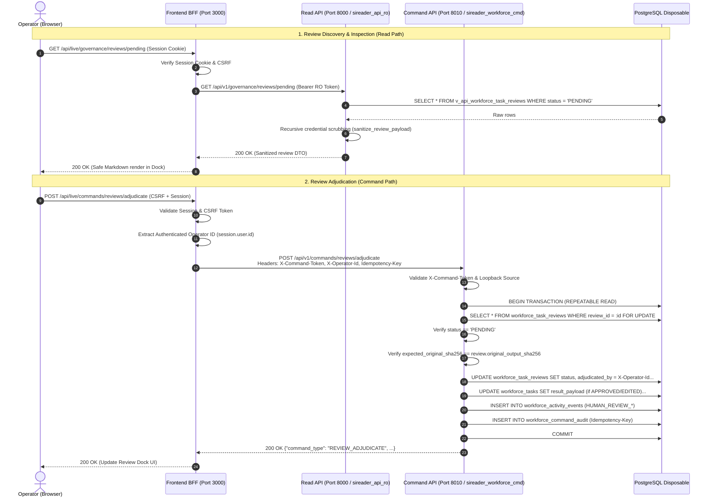

# SIREADER Phase 5.2.2 - Human Output Review Subsystem Architecture Proposal
**Subsystem:** Human Output Review, Quality Adjudication & Governance  
**Checkpoint:** 5.2.2-A (Architecture Proposal & Review Policy Specification)  
**Status:** PROPOSED FOR ARCHITECTURAL REVIEW (Revision 1.1.0 - Incorporating ChatGPT Review Amendments)  
**Target Branches:** `phase-5-implementation` (SIREADER & SIREADER-Python-Backend)  
**Security Level:** Air-Gapped Local Disposable Staging (Strictly Zero LIVE Supabase / Paid Provider Exposure)  
**Lead Reviewer:** ChatGPT (Architecture & Review)  
**Pair Programmer:** Antigravity (Implementation & Acceptance)  
**Document Revision:** 1.1.0  

---

## 1. Executive Summary & Design Vision

In Phase 5.2.1, we hardened the append-only activity ledger (`workforce_activity_events`), enforced sequential event ordering (`event_seq`), established tamper-proof database triggers rejecting mutations, implemented single direct retry lineage, and delivered the audited timeline reconstruction endpoint (`GET /api/v1/workforce/tasks/{task_id}/timeline`).

Checkpoint 5.2.2 establishes the **Human Output Review Subsystem**. While Phase 4 enabled autonomous worker task execution, certain non-trading task outputs (e.g. strategic syntheses, complex research reports, data summaries, policy evaluations) require human operator verification or editorial adjustment before downstream release or final consumption.

### Key Architectural Invariants in Revision 1.1.0:
1. **Strict Tripartite Lifecycle Separation:** Worker execution success (`COMPLETED`), provider network uncertainty (`WAITING_REVIEW`), and human quality adjudication (`workforce_task_reviews`) are decoupled into three distinct, non-overlapping lifecycles.
2. **Gated Output Release:** When a task requires human review, worker completion does **not** expose output into `workforce_tasks.result_payload`. Output remains quarantined inside `workforce_task_reviews` until approved or edited by an authorized operator.
3. **Rejection Independence:** A human rejection indicates editorial inadequacy of the deliverable, not a technical execution failure. The task execution status remains `COMPLETED`, while the review transitions to `REJECTED`. Rejection does not trigger or overload the Phase 5.1 `TASK_RETRY` mechanism.
4. **Active Review Retention Protection:** Pending reviews are protected from retention purging (`payload_purged_at`) and feature an explicit `EXPIRED` lifecycle transition.
5. **Layered Content Sanitization:** Multi-layered defense where backend sanitizer functions recursively scrub credentials from payloads before delivery to security-barrier views.
6. **Trusted Operator Identity Delegation:** The Command API (`127.0.0.1:8010`) extracts operator identity exclusively from trusted BFF internal headers (`X-Operator-Id`), never accepting unverified actor claims from the browser.
7. **Referential Integrity & Audit Permanence:** Foreign keys use `ON DELETE RESTRICT` to guarantee that human governance decisions are never destroyed by cascade deletions.

---

## 2. Hard Boundaries & Invariants

All designs and implementations within Checkpoint 5.2.2 strictly adhere to the following invariants:
1. **Zero Supabase LIVE Interaction:** Target exclusively the local disposable PostgreSQL instance (`127.0.0.1:5432`). Supabase LIVE (`otinrvvfjnyxjvzcmdia`) remains completely untouched.
2. **Zero Paid Provider Invocations:** All automated tests and verifications use mock/simulated fixtures. Real LLM APIs remain completely dormant.
3. **Strict Trading Boundary Decoupling:** Non-trading output review is entirely independent of MT5/HFM trading bridges, order placement, position sizing, SL/TP rules, and trading risk approvals (`approval_decisions`).
4. **Zero Main Branch Commits:** All changes remain isolated on branch `phase-5-implementation`.
5. **Zero Secret Leakage:** No bearer tokens, passwords, database credentials, or unsanitized payloads are logged or exposed to the client.
6. **No Speculative Implementation Code in 5.2.2-A:** This document constitutes the design and review policy contract. Implementation code begins only after ChatGPT review and signoff.

---

## 3. Review Policy & Eligibility Matrix

### 3.1. Non-Trading Scope & Hard Trading Ban
The review subsystem strictly processes **non-trading operational artifacts**. Under no circumstances can a trading order, position management request, broker command, or financial risk decision be submitted to or adjudicated by `workforce_task_reviews`. Trading approvals continue to be governed exclusively by the dedicated `approval_decisions` table and MT5 risk engine.

### 3.2. Authoritative Capability & Task Type Allowlist
Eligibility for human output review is determined exclusively by backend policy logic. A task is eligible for human review if and only if its `(required_capability, task_type)` tuple matches an authorized entry in the backend's authoritative catalog (`app/workers/registry.py`):

| Required Capability | Authoritative Task Types | Review Trigger Mode | Default Rationale |
| :--- | :--- | :--- | :--- |
| `quick_research` | `QUICK_RESEARCH`, `RESEARCH` | Sampled (Deterministic) | Fast research synthesis; spot-checked for factual consistency. |
| `information_extraction` | `INFORMATION_EXTRACTION`, `CLASSIFICATION` | Policy-based | Entity extraction; reviewed when source document confidence is low. |
| `summarization` | `SUMMARIZATION`, `CLASSIFICATION` | Optional / On-demand | Executive summaries; reviewed prior to external distribution. |
| `data_analysis` | `DATA_ANALYSIS`, `REASONING` | Mandatory if Flagged | Quantitative analysis; audited for methodology integrity. |
| `comparison` | `COMPARISON`, `REASONING` | Policy-based | Multi-criteria evaluations; checked against decision rubrics. |
| `evaluation` | `EVALUATION`, `REASONING` | Mandatory | Artifact checklists; verified by human reviewer. |
| `structured_reasoning` | `STRUCTURED_REASONING`, `REASONING` | Policy-based | Multi-step reasoning chains; validated for premise validity. |
| `complex_reasoning` | `COMPLEX_REASONING`, `ESCALATION` | Mandatory | High-complexity escalations (Opus tier); requires signoff. |
| `strategic_analysis` | `STRATEGIC_ANALYSIS`, `ESCALATION` | Mandatory | Strategic roadmap recommendations; requires signoff. |
| `deep_review` | `DEEP_REVIEW`, `ESCALATION` | Mandatory | In-depth architectural/procedural audits; requires signoff. |
| `data_archiving` | `DATA_ARCHIVING`, `ARCHIVAL` | Policy-based | State archival records; spot-checked for schema compliance. |

*Any task type or capability not explicitly enumerated in the backend catalog is strictly barred from entering the review subsystem.*

### 3.3. Backend-Owned Evaluation & Deterministic Sampling
Client-supplied flags (such as a request body `requires_human_review: bool`) are **untrusted and ignored** by the runtime. Review eligibility is evaluated exclusively server-side upon worker attempt completion:

```python
POLICY_VERSION = "2026.11.01"

def evaluate_review_eligibility(task: WorkTaskRecord, capability_spec: CapabilityContract) -> bool:
    if (task.required_capability, task.task_type) not in AUTHORIZED_REVIEW_ALLOWLIST:
        return False
        
    policy = capability_spec.review_policy  # MANDATORY | SAMPLE | ON_DEMAND | NONE
    if policy == "MANDATORY":
        return True
    if policy == "SAMPLE":
        # Deterministic hash-based sampling (reproducible across test and audit)
        hash_input = f"{POLICY_VERSION}:{task.task_id}:{capability_spec.sample_salt}"
        bucket = int(hashlib.sha256(hash_input.encode()).hexdigest(), 16) % 100
        return bucket < capability_spec.sample_rate_percent
    if policy == "ON_DEMAND":
        return task.policy_tags.get("require_review") is True
    return False
```

---

## 4. Lifecycle Architecture & Decoupling

### 4.1. The Three Distinct System Lifecycles

To prevent ambiguity, the system establishes three strictly separate state machines:

```
┌─────────────────────────────────────────────────────────────────────────────┐
│ 1. Task Execution Lifecycle (workforce_tasks.status)                        │
│    QUEUED ──► CLAIMED ──► RUNNING ──► COMPLETED (or FAILED / CANCELLED)     │
└─────────────────────────────────────────────────────────────────────────────┘
                                      │
          If execution succeeded and requires_review == True:
                                      ▼
┌─────────────────────────────────────────────────────────────────────────────┐
│ 2. Human Output Review Lifecycle (workforce_task_reviews.status)            │
│    PENDING ──► APPROVED (releases original_output to result_payload)        │
│             ──► EDITED   (releases adjusted_output to result_payload)        │
│             ──► REJECTED (output quarantined; result_payload remains NULL)   │
│             ──► EXPIRED  (timed out; output quarantined; audit recorded)    │
└─────────────────────────────────────────────────────────────────────────────┘

┌─────────────────────────────────────────────────────────────────────────────┐
│ 3. Provider Uncertainty Lifecycle (Existing Phase 4 WAITING_REVIEW)         │
│    Provider HTTP 504 / Network Drop ──► Cost Guard Quarantine               │
│    (STRICTLY UNRELATED TO HUMAN OUTPUT REVIEW)                              │
└─────────────────────────────────────────────────────────────────────────────┘
```

### 4.2. Gated Output Release Mechanism

1. **Attempt Completion:** Worker executes attempt to completion (`workforce_task_attempts.status = 'COMPLETED'`).
2. **Review Quarantining:**
   - If `requires_review == True`:
     - `workforce_tasks.status = 'COMPLETED'` (execution succeeded technically).
     - `workforce_tasks.result_payload = NULL` (quarantined; downstream consumers cannot read unapproved output).
     - `workforce_task_reviews` record inserted with `status = 'PENDING'`, storing `original_output` and canonical `original_output_sha256`.
     - Event `HUMAN_REVIEW_QUEUED` emitted.
   - If `requires_review == False`:
     - `workforce_tasks.status = 'COMPLETED'`.
     - `workforce_tasks.result_payload = attempt_output` (released immediately).
3. **Adjudication Release:**
   - **On `APPROVED`:** `workforce_tasks.result_payload` is populated with `original_output`. Review status becomes `APPROVED`. Output is now readable downstream.
   - **On `EDITED`:** `workforce_tasks.result_payload` is populated with `adjusted_output`. Review status becomes `EDITED`. Original and adjusted payloads are permanently preserved.
   - **On `REJECTED`:** `workforce_tasks.result_payload` remains `NULL`. Review status becomes `REJECTED`. Task status remains `COMPLETED` (worker succeeded, but deliverable was rejected).
   - **On `EXPIRED`:** If unadjudicated past `review_expires_at`, review status becomes `EXPIRED`. Output remains unreleased (`NULL`).

### 4.3. Rejection & Retry Boundary
A human output rejection is **not a technical execution failure**:
- The worker successfully executed the task and consumed authorized tokens.
- Phase 5.1 `TASK_RETRY` (`retry_failed_non_trading_task`) requires `status == 'FAILED'` with a failed attempt and safe provider state. It cannot and must not be used for review rejections.
- For Checkpoint 5.2.2, a rejected task remains `COMPLETED` with `result_payload = NULL` and `workforce_task_reviews.status = 'REJECTED'`.
- If an operator wishes to rerun a rejected task, it must be submitted as a brand-new task enqueue (`TASK_ENQUEUE`) with a fresh idempotency key and correlation ID.

---

## 5. End-to-End Authorization & Data-Flow



---

## 6. Data Model & Storage Lifecycle

### 6.1. Database Schema (`public.workforce_task_reviews`)

```sql
CREATE TABLE IF NOT EXISTS public.workforce_task_reviews (
    review_id VARCHAR(64) PRIMARY KEY,
    task_id VARCHAR(64) NOT NULL REFERENCES public.workforce_tasks(task_id) ON DELETE RESTRICT,
    attempt_id VARCHAR(64) NOT NULL REFERENCES public.workforce_task_attempts(attempt_id) ON DELETE RESTRICT,
    status VARCHAR(24) NOT NULL DEFAULT 'PENDING',
    original_output JSONB NOT NULL,
    original_output_sha256 CHAR(64) NOT NULL,
    adjusted_output JSONB,
    adjudicated_by VARCHAR(100),
    adjudicated_at TIMESTAMPTZ,
    notes TEXT,
    review_expires_at TIMESTAMPTZ NOT NULL,
    created_at TIMESTAMPTZ NOT NULL DEFAULT NOW(),
    updated_at TIMESTAMPTZ NOT NULL DEFAULT NOW(),

    CONSTRAINT uq_workforce_task_reviews_task UNIQUE (task_id),
    CONSTRAINT ck_workforce_task_reviews_status CHECK (
        status IN ('PENDING', 'APPROVED', 'EDITED', 'REJECTED', 'EXPIRED')
    ),
    CONSTRAINT ck_workforce_task_reviews_sha256_len CHECK (
        length(original_output_sha256) = 64
    ),
    CONSTRAINT ck_workforce_task_reviews_payload_size CHECK (
        pg_column_size(original_output) <= 524288 AND
        (adjusted_output IS NULL OR pg_column_size(adjusted_output) <= 524288)
    ),
    CONSTRAINT ck_workforce_task_reviews_adjudication CHECK (
        (status IN ('PENDING', 'EXPIRED') AND adjudicated_at IS NULL AND adjudicated_by IS NULL) OR
        (status IN ('APPROVED', 'EDITED', 'REJECTED') AND adjudicated_at IS NOT NULL AND adjudicated_by IS NOT NULL)
    ),
    CONSTRAINT ck_workforce_task_reviews_edited CHECK (
        (status = 'EDITED' AND adjusted_output IS NOT NULL) OR
        (status != 'EDITED')
    ),
    CONSTRAINT ck_workforce_task_reviews_rejected CHECK (
        (status = 'REJECTED' AND notes IS NOT NULL AND length(trim(notes)) > 0) OR
        (status != 'REJECTED')
    )
);

CREATE INDEX IF NOT EXISTS ix_workforce_task_reviews_status_created 
    ON public.workforce_task_reviews (status, created_at DESC);
CREATE INDEX IF NOT EXISTS ix_workforce_task_reviews_expires 
    ON public.workforce_task_reviews (review_expires_at) WHERE status = 'PENDING';
```

### 6.2. Immutability Triggers

To prevent tampering with historical reviews:
1. `original_output` and `original_output_sha256` are strictly immutable once created.
2. Once a review transitions to a terminal state (`APPROVED`, `EDITED`, `REJECTED`, `EXPIRED`), no subsequent update is permitted.

```sql
CREATE OR REPLACE FUNCTION public.sireader_guard_review_mutation_v1()
RETURNS TRIGGER AS $$
BEGIN
    -- Reject changes to immutable original output
    IF OLD.original_output IS DISTINCT FROM NEW.original_output OR
       OLD.original_output_sha256 IS DISTINCT FROM NEW.original_output_sha256 THEN
        RAISE EXCEPTION 'Original review output and SHA256 hash are immutable.';
    END IF;

    -- Reject changes once terminal
    IF OLD.status IN ('APPROVED', 'EDITED', 'REJECTED', 'EXPIRED') THEN
        RAISE EXCEPTION 'Terminal review state % cannot be modified.', OLD.status;
    END IF;

    NEW.updated_at = NOW();
    RETURN NEW;
END;
$$ LANGUAGE plpgsql;

CREATE TRIGGER trg_workforce_task_reviews_guard
BEFORE UPDATE ON public.workforce_task_reviews
FOR EACH ROW EXECUTE FUNCTION public.sireader_guard_review_mutation_v1();
```

### 6.3. Cryptographic Integrity Hash Definition
The hash is computed exclusively server-side using strict canonical JSON serialization:
$$\text{original\_output\_sha256} = \text{SHA256}(\text{json.dumps}(original\_output, sort\_keys=True, separators=(',', ':'), ensure\_ascii=False).encode('utf-8'))$$

### 6.4. Retention & Purging Policy
1. **Pending Review Shield:** The Phase 4 `purge_expired_task_payloads()` query is modified with a strict `NOT EXISTS` guard:
   ```sql
   WHERE NOT EXISTS (
       SELECT 1 FROM public.workforce_task_reviews r
       WHERE r.task_id = t.task_id AND r.status = 'PENDING'
   )
   ```
2. **Review Expiration Job:** A background sweeper inspects `WHERE status = 'PENDING' AND review_expires_at < NOW()`. Stale reviews transition to `EXPIRED`, emitting `HUMAN_REVIEW_EXPIRED`.
3. **Terminal Purging:** Once terminal, after task `payload_expires_at` elapses, `original_output` and `adjusted_output` are sanitized/nulled while preserving `original_output_sha256`, `status`, `adjudicated_by`, `adjudicated_at`, and `notes` permanently.

---

## 7. Security, Sanitization & Read API

### 7.1. Layered Defense Architecture

| Layer | Responsibility | Mechanism |
| :--- | :--- | :--- |
| **1. Database Role Boundary** | Deny direct base table access to API roles. | `REVOKE ALL ON public.workforce_task_reviews FROM public, sireader_api_ro;` |
| **2. Security-Barrier View** | Encapsulate row-level access under security barrier. | View `v_api_workforce_task_reviews` owned by `sireader_view_owner`. |
| **3. Application Sanitizer** | Deep recursive credential scrubbing in Python. | `sanitize_review_payload()` parses JSON structures and regex-scrubs keys and values. |
| **4. Transport Layer (BFF)** | Same-origin loopback proxy with strict DTO validation. | Rejects SSRF, verifies operator session and CSRF. |
| **5. Frontend UI Presentation** | XSS and script injection prevention. | Sanitized Markdown rendering (`rehype-sanitize`) with inert code blocks. |

### 7.2. Backend Application Sanitizer (`app/ai/sanitizer.py`)
Before any payload is returned by the Read API (Port 8000), it passes through `sanitize_review_payload()`:
- Redacts sensitive keys: `token`, `secret`, `password`, `key`, `authorization`, `cookie`, `credential`.
- Scans string values for pattern-based leaks (e.g. `Bearer eyJ...`, `postgres://...`, API keys).
- Matches are replaced with `[REDACTED]`.

### 7.3. Read API Endpoints (Port 8000)
- `GET /api/v1/governance/reviews/pending?limit=20&offset=0&required_capability=quick_research`
- `GET /api/v1/governance/reviews/{review_id}`
- Accessible exclusively by role `sireader_api_ro`.

---

## 8. Command API & Trusted Operator Adjudication

### 8.1. Command Specification (Port 8010)
- Endpoint: `POST /api/v1/commands/reviews/adjudicate`
- Bound strictly to `127.0.0.1:8010`.
- Required Headers:
  - `X-Command-Token`: matches `SIREADER_WORKFORCE_COMMAND_TOKEN`.
  - `X-Operator-Id`: authenticated operator username/ID passed by BFF.
  - `Idempotency-Key`: UUID v4 for anti-replay.

### 8.2. Request & Response Contracts

```python
class ReviewAdjudicationDecision(str, Enum):
    APPROVE = "APPROVE"
    EDIT = "EDIT"
    REJECT = "REJECT"

class ReviewAdjudicationRequest(BaseModel):
    model_config = ConfigDict(extra="forbid")
    
    review_id: str = Field(..., min_length=1, max_length=64)
    decision: ReviewAdjudicationDecision
    expected_original_sha256: str = Field(..., min_length=64, max_length=64)
    adjusted_output: dict[str, Any] | None = None
    notes: str | None = Field(None, max_length=2000)

    @model_validator(mode="after")
    def validate_semantics(self) -> Self:
        if self.decision == ReviewAdjudicationDecision.EDIT:
            if not self.adjusted_output:
                raise ValueError("adjusted_output is required when decision is EDIT")
        if self.decision == ReviewAdjudicationDecision.REJECT:
            if not self.notes or not self.notes.strip():
                raise ValueError("notes (rejection reason) is required when decision is REJECT")
        return self
```

### 8.3. Idempotency & Concurrency Guarantees
1. `SELECT ... FOR UPDATE` row lock acquired on `workforce_task_reviews`.
2. If row locked and `status != 'PENDING'`: returns `409 CONFLICT (REVIEW_ALREADY_ADJUDICATED)`.
3. If `expected_original_sha256 != original_output_sha256`: returns `409 CONFLICT (STALE_REVIEW_SNAPSHOT)`.
4. Command replay with identical `Idempotency-Key` and matching payload returns cached response without duplicate event emission.
5. Command replay with identical `Idempotency-Key` and conflicting payload returns `409 CONFLICT (IDEMPOTENCY_KEY_REUSE_PAYLOAD_MISMATCH)`.

---

## 9. Append-Only Audit Event Ledger

All transitions record immutable events into `public.workforce_activity_events`:

| Event Type | Actor Type | Actor ID Source | Event Payload Contents |
| :--- | :--- | :--- | :--- |
| `HUMAN_REVIEW_QUEUED` | `SYSTEM` | `system` | `{"review_id": "...", "original_sha256": "..."}` |
| `HUMAN_REVIEW_APPROVED` | `OPERATOR` | `X-Operator-Id` | `{"review_id": "...", "original_sha256": "..."}` |
| `HUMAN_REVIEW_EDITED` | `OPERATOR` | `X-Operator-Id` | `{"review_id": "...", "original_sha256": "...", "adjusted_sha256": "..."}` |
| `HUMAN_REVIEW_REJECTED` | `OPERATOR` | `X-Operator-Id` | `{"review_id": "...", "reason_code": "QUALITY_REJECTED"}` |
| `HUMAN_REVIEW_EXPIRED` | `SYSTEM` | `system` | `{"review_id": "...", "original_sha256": "..."}` |

*Audit payloads contain cryptographic hashes and structured reason codes only. Raw outputs and free-form notes are strictly excluded from activity events to maintain audit ledger privacy.*

---

## 10. Migration Outline

### 10.1. Forward Migration (`2026_11_09_workforce_reviews_v1.sql`)
1. Create table `public.workforce_task_reviews` with all check constraints and payload size caps.
2. Create indexes for status and expiration sweeper.
3. Attach before-update trigger `trg_workforce_task_reviews_guard`.
4. Create security-barrier view `public.v_api_workforce_task_reviews`.
5. Grant `SELECT` on view to `sireader_api_ro`.
6. Grant `SELECT, INSERT, UPDATE` on table to `sireader_workforce_cmd`.
7. Revoke direct base table access from `sireader_api_ro` and `public`.

### 10.2. Rollback Migration (`2026_11_09_workforce_reviews_v1_rollback.sql`)
1. Revoke grants on view and table.
2. Drop view `public.v_api_workforce_task_reviews`.
3. Drop trigger and trigger function.
4. Drop table `public.workforce_task_reviews`.

---

## 11. Comprehensive Revised Test Matrix

| # | Layer | Test Scenario | Expected Outcome |
| :--- | :--- | :--- | :--- |
| 1 | **Lifecycle** | Eligible task execution succeeds (`requires_review = True`). | Task marked `COMPLETED`; `result_payload` is `NULL`; review created with `PENDING`. |
| 2 | **Adjudication** | Operator approves review (`APPROVE`). | Review marked `APPROVED`; `result_payload` populated with `original_output`. |
| 3 | **Adjudication** | Operator edits review (`EDIT`). | Review marked `EDITED`; `result_payload` populated with `adjusted_output`. |
| 4 | **Adjudication** | Operator rejects review (`REJECT`). | Review marked `REJECTED`; `result_payload` remains `NULL`; task stays `COMPLETED`. |
| 5 | **Retention** | Background payload purge runs while review is `PENDING`. | Pending review payload is shielded and NOT purged. |
| 6 | **Expiration** | Review exceeds `review_expires_at` without adjudication. | Background sweeper marks review `EXPIRED`; emits `HUMAN_REVIEW_EXPIRED`. |
| 7 | **Concurrency** | Two concurrent adjudication requests on identical `review_id`. | Row-level lock (`FOR UPDATE`) allows one to succeed; second receives `409 REVIEW_ALREADY_ADJUDICATED`. |
| 8 | **Idempotency** | Replay adjudication request with identical `Idempotency-Key` and payload. | Returns 200 OK with cached response; zero duplicate events. |
| 9 | **Idempotency** | Replay adjudication request with identical key but different decision/payload. | Rejection with `409 IDEMPOTENCY_KEY_REUSE_PAYLOAD_MISMATCH`. |
| 10 | **Integrity** | Adjudication submitted with mismatched `expected_original_sha256`. | Rejection with `409 STALE_REVIEW_SNAPSHOT`. |
| 11 | **Identity** | Client attempts to send forged `adjudicated_by` in request body. | Body field ignored; identity taken exclusively from trusted `X-Operator-Id` header. |
| 12 | **Security** | Role `sireader_api_ro` attempts `SELECT` directly on `workforce_task_reviews`. | Rejected with `permission denied for table workforce_task_reviews`. |
| 13 | **Sanitization** | Worker output contains API key / Bearer token. | Read API scrubs pattern; response contains `[REDACTED]`. |
| 14 | **Referential** | Direct attempt to delete `workforce_tasks` record referenced by review. | Rejected by `ON DELETE RESTRICT` constraint. |

---

## 12. Sub-unit Implementation Roadmap

```
[5.2.2-A] Architecture & Policy Proposal (Rev 1.1.0 - THIS DOCUMENT)
   │
   ▼ (Upon Review & Signoff)
[5.2.2-B] Database Schema & Backend Review Repository
   │  - Migration 2026_11_09_workforce_reviews_v1.sql & rollback
   │  - SQLAlchemy models, immutability trigger, & sanitizers
   │  - Local PostgreSQL unit tests covering scenarios 1, 5, 6, 12, 14
   │
   ▼
[5.2.2-C] Adjudication Command API (Port 8010)
   │  - POST /api/v1/commands/reviews/adjudicate
   │  - Concurrency, idempotency & trusted actor tests (scenarios 2, 3, 4, 7, 8, 9, 10, 11)
   │
   ▼
[5.2.2-D] Governance Read API & Secure BFF Proxy (Port 8000 & 3000)
   │  - GET /api/v1/governance/reviews/pending and GET /{id}
   │  - Security-barrier view, role privilege audit, & sanitization (scenario 13)
   │  - BFF loopback proxy & CSRF protection
   │
   ▼
[5.2.2-E] Review Inbox UI & End-to-End Acceptance
      - Safe Markdown renderer component (rehype-sanitize)
      - LIVE Review Dock panel with diff inspector
      - Full acceptance testing in local browser & execution log closeout
```

---

## 13. Verification Checklist for Revision 1.1.0

- [x] Task `status = WAITING_REVIEW` completely removed from Human Output Review design.
- [x] Distinct tripartite lifecycles established (Task Execution vs Human Review vs Provider Uncertainty).
- [x] Gated output release mechanism defined (unapproved output quarantined from `result_payload`).
- [x] Manual retry promise removed; rejection does not overload `TASK_RETRY`.
- [x] Active reviews protected from retention purge; `EXPIRED` lifecycle transition specified.
- [x] Layered content sanitization designed (Python recursive scrubber + security-barrier view + safe Markdown).
- [x] Foreign key cascade deleted; replaced with `ON DELETE RESTRICT` for audit permanence.
- [x] Trusted operator identity delegated via BFF internal header `X-Operator-Id` to Command API.
- [x] Eligibility validated against authoritative `(capability, task_type)` catalog with deterministic sampling.
- [x] Canonical JSON hashing specified mathematically and server-side calculated.
- [x] Audit event payloads stripped of raw outputs and free-form notes.
- [x] Comprehensive 14-scenario test matrix documented.
- [x] Strictly zero implementation code written prior to architectural signoff.
