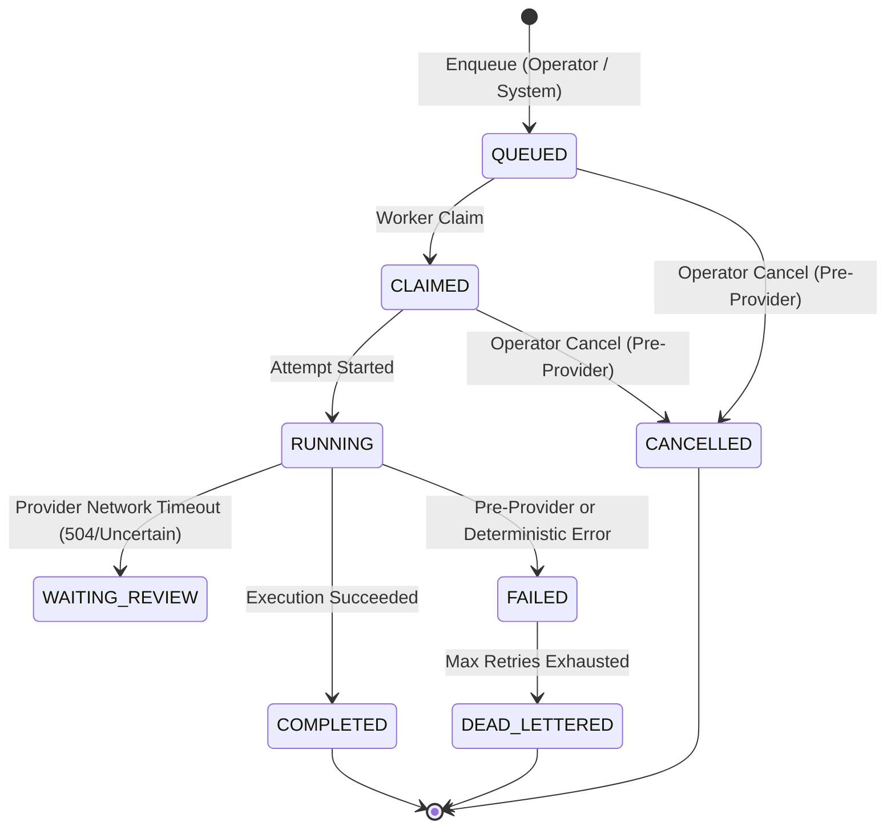

# SIREADER Phase 5.2 - Architecture & Governance Proposal
**Subsystem:** Workforce Operations, Observability, and Governance  
**Status:** APPROVED WITH REQUIRED DESIGN AMENDMENTS  
**Target Branches:** `phase-5-implementation` (SIREADER & SIREADER-Python-Backend)  
**Security Level:** Air-Gapped Local Disposable Staging (Strictly Zero LIVE Supabase / Paid Provider Exposure)  
**Lead Reviewer:** ChatGPT (Architecture & Review)  
**Pair Programmer:** Antigravity (Implementation & Acceptance)  
**Document Revision:** 1.1.0 (Incorporates Architectural Review Amendments)

---

## 1. Executive Summary & Vision

Phase 5.1 established secure local command orchestration (`TASK_ENQUEUE`, `TASK_CANCEL`, `TASK_RETRY`, `WORKER_SCHEDULING_SET`) via a loopback-isolated Command API (`127.0.0.1:8010`) and frontend BFF proxy.

Phase 5.2 advances the system from isolated task execution into **comprehensive operational governance**:
1. **Lifecycle Audit Ledger & Timeline Reconstruction:** Deepening and hardening the existing `workforce_activity_events` ledger with deterministic identity sequence ordering, append-only database triggers, actor attribution, and explicit retry lineage.
2. **Human Output Review Subsystem:** Establishing an operator review queue for non-trading AI outputs, strictly decoupled from financial trading approvals (`approval_decisions`) and provider network uncertainty (`WAITING_REVIEW`).
3. **Budget Governance & Cost Guard Observability:** Unifying spend tracking through the Phase 4 `Cost Guard` using canonical statuses (`COMPLETED`, `RESERVED`, `UNKNOWN`) to prevent double-counting.
4. **Governed Model Escalation & Policy Engine:** Defining deterministic capability routing across model tiers (Haiku $\rightarrow$ Sonnet $\rightarrow$ Opus) with pre-execution budget validation and an allowlist-driven sensitive task rejection gate.

---

## 2. Hard Boundaries & Invariants

All designs and implementations must strictly adhere to the following invariants:
1. **No Supabase LIVE Interaction:** Target only the local disposable PostgreSQL instance (`127.0.0.1:54322`). Supabase LIVE (`otinrvvfjnyxjvzcmdia`) must never receive migrations or connections.
2. **No Paid Provider or Automated Dispatch:** All tests must execute against mock providers and simulated fixtures. Real Anthropic/OpenAI APIs remain deactivated.
3. **Trading Boundary Isolation:** No changes to MT5/HFM bridge, trade execution, broker connectivity, or trading risk rules (`approval_decisions`).
4. **No Git Merge to Main:** All work stays on `phase-5-implementation`.
5. **No Secret or Credential Leakage:** No tokens, passwords, bearer keys, database URLs, or raw sensitive payloads may be logged, committed, or exposed to the frontend.
6. **No Duplicate Ledgers or Guards:** Extend existing Phase 4 tables (`workforce_activity_events`, `workforce_tasks`, `workforce_task_attempts`, `workforce_command_audit`) and the Phase 4 `Cost Guard`.

---

## 3. Subsystem Architecture & Design Amendments

### 3.1. Canonical Task Lifecycle Audit & Ledger Hardening

Every task executed by the workforce maintains a continuous, unbroken, and immutable chain of custody.

#### Task State Machine


#### Deterministic Retry Lineage Principle
- When an operator retries a failed task, the original task **remains in its terminal state (`FAILED`)**. Its history is never rewritten or cleared.
- A **new task** is generated with `status = 'QUEUED'`.
- The new task maintains an explicit link to the progenitor via `related_task_id` / `retry_of_task_id`.
- An explicit audit event (`TASK_RETRIED`) is recorded atomically with the retry command, capturing the operator actor, old task ID, and newly queued task ID.

#### Event Ledger Immutability & Determinism (Hardening `workforce_activity_events`)
1. **Existing Infrastructure Extension:** Rather than creating a secondary event table, we reinforce `public.workforce_activity_events`.
2. **Deterministic Sequence Ordering:** Add `event_seq BIGINT GENERATED ALWAYS AS IDENTITY` to provide strict monotonic event ordering across concurrent events sharing identical millisecond timestamps. The existing `event_id varchar(64)` is preserved.
3. **Trusted Actor Attribution:** Add `actor_type` (`SYSTEM`, `WORKER`, `OPERATOR`, `LEGACY_UNKNOWN`) and `actor_id` (e.g. `supervisor`, `haiku`, `local_operator`). Actor identity is injected strictly by the backend trusted runtime context, never accepted blindly from client inputs.
4. **Explicit Lineage Tracking:** Add `related_task_id varchar(64) REFERENCES public.workforce_tasks(task_id)` to trace retry relationships and multi-stage task lineage.
5. **Database-Level Immutability:** An append-only PostgreSQL trigger denies all `UPDATE`, `DELETE`, and `TRUNCATE` operations on `workforce_activity_events`.

---

### 3.2. Human Output Review Subsystem

The human review pipeline provides high-confidence operator oversight for tasks requiring human inspection before their outputs are considered authoritative.

#### Distinction Matrix
- **`HUMAN_OUTPUT_REVIEW` (Phase 5.2):** Validates the substantive quality, correctness, and adherence of AI-generated work (e.g. summary accuracy, research completeness).
- **`WAITING_REVIEW` (Phase 4):** A technical failure-stop state indicating provider network uncertainty (e.g. HTTP 504 where provider execution cannot be verified).
- **`approval_decisions` (Phase 3 Core):** Financial risk approval for trading signals before MT5 execution.

#### Review Lifecycle & States
```typescript
export type HumanReviewStatus = 
  | 'PENDING'    // Task output ready, awaiting human operator
  | 'APPROVED'   // Operator confirmed output as valid and accepted
  | 'EDITED'     // Operator edited/corrected output before approval
  | 'REJECTED';  // Operator rejected output
```

#### Review Record Schema (`workforce_task_reviews`)
```sql
CREATE TABLE IF NOT EXISTS public.workforce_task_reviews (
    review_id VARCHAR(64) PRIMARY KEY,
    task_id VARCHAR(64) NOT NULL REFERENCES public.workforce_tasks(task_id) ON DELETE RESTRICT,
    attempt_number INTEGER NOT NULL,
    reviewer_id VARCHAR(64) NOT NULL,
    status VARCHAR(32) NOT NULL,
    original_output JSONB NOT NULL,
    adjusted_output JSONB,
    operator_notes TEXT,
    rejection_reason VARCHAR(64),
    reviewed_at TIMESTAMPTZ,
    created_at TIMESTAMPTZ NOT NULL DEFAULT NOW(),
    CONSTRAINT ck_workforce_task_review_status CHECK (
        status IN ('PENDING', 'APPROVED', 'EDITED', 'REJECTED')
    )
);
CREATE INDEX IF NOT EXISTS idx_workforce_task_reviews_pending 
ON public.workforce_task_reviews(created_at) WHERE status = 'PENDING';
```

---

### 3.3. Authoritative Budget & Cost Governance

Leveraging the Phase 4 `Cost Guard` (`app.ai.cost_guard`), Phase 5.2 exposes real-time operational budget metrics.

#### Canonical Spend Statuses (No Double-Counting)
- **`COMPLETED` Spend:** Actual finalized cost recorded upon successful provider response.
- **`RESERVED` Spend:** In-flight allocations currently active in running attempts.
- **`UNKNOWN` Exposure:** At-risk exposure from tasks stuck in `WAITING_REVIEW` where provider completion cannot be guaranteed.
- **Invariant:** Attempt `cost_amount` and `ai_usage_logs` must never be summed simultaneously to prevent duplicate cost calculation.

#### Budget Validation
$$\text{Available Budget} = \text{Hard Cap} - (\text{COMPLETED} + \text{RESERVED} + \text{UNKNOWN})$$
Before dispatching any provider request, the Cost Guard validates that the estimated request cost does not exceed `Available Budget`. If exceeded, dispatch is blocked with `BUDGET_EXCEEDED`.

---

### 3.4. Model Escalation & Policy Engine

1. **Model Tier Hierarchy:**
   - **Tier 1 — FAST (`haiku`):** Intake, preliminary data normalization, structured routing.
   - **Tier 2 — REASONING (`sonnet`):** Deep quantitative analysis, synthesis, structural reports.
   - **Tier 3 — ESCALATION (`opus`):** High-complexity edge cases, strategic conflict adjudication.
2. **Policy-Driven Routing:**
   - Capability and task allowlists dictate the baseline assigned worker and model tier.
   - Escalation triggers (e.g. low confidence or operator request) must pass the budget gate before upgrading from Tier 1 to Tier 2 or Tier 3.
   - Sensitive work rejection relies on deterministic capability allowlists and policy checks; keyword filtering serves as an auxiliary defense layer.

---

### 3.5. Timeline Read API & Security-Barrier View

#### Architecture Boundary
- **Observability Port 8000:** Timeline is an observability feature and is served exclusively by the read-only FastAPI application (`127.0.0.1:8000`).
- **Command Port 8010:** Remains strictly write-only for idempotent operator commands. `sireader_workforce_cmd` role does not receive read grants for general database tables.
- **Security-Barrier Database View (`workforce_task_timeline_view`):**
  - Sanitizes sensitive contents: excludes raw input/output payloads, secrets, bearer tokens, lease tokens, request fingerprints, and idempotency keys.
  - Exposes: `event_seq`, `event_id`, `task_id`, `event_type`, `occurred_at`, `actor_type`, `actor_id`, `worker_id`, `attempt_id`, `related_task_id`, and sanitized event summary metadata.
  - Granted `SELECT` only to `sireader_api_ro`.

---

## 4. API Contracts & BFF Surface

| Method | Endpoint | Description | Port / Role |
| :--- | :--- | :--- | :--- |
| `GET` | `/api/v1/workforce/tasks/{id}/timeline` | Bounded chronological task timeline | Port 8000 (`sireader_api_ro`) |
| `GET` | `/api/v1/governance/reviews/pending` | Operator review inbox queue | Port 8000 (`sireader_api_ro`) |
| `POST` | `/api/v1/commands/reviews/adjudicate` | Approve, edit, or reject task output | Port 8010 (`sireader_workforce_cmd`) |
| `GET` | `/api/v1/governance/budgets/status` | Real-time budget breakdown | Port 8000 (`sireader_api_ro`) |
| `POST` | `/api/v1/commands/tasks/escalate` | Explicit tier escalation command | Port 8010 (`sireader_workforce_cmd`) |

---

## 5. Implementation Checkpoints & Phasing

| Checkpoint | Scope | Output Deliverables |
| :--- | :--- | :--- |
| **5.2.0** | Architecture Proposal & Amendments | `docs/PHASE_5_2_ARCHITECTURE_PROPOSAL.md` signed off. |
| **5.2.1** | Lifecycle Audit Ledger & Timeline API | Event ledger hardening, identity seq, append-only trigger, sanitized view, timeline route, BFF, tests. |
| **5.2.2** | Human Review Subsystem | `workforce_task_reviews` table, adjudication command, review inbox UI. |
| **5.2.3** | Budget Governance | Canonical spend aggregation (`COMPLETED`, `RESERVED`, `UNKNOWN`), budget gauge UI. |
| **5.2.4** | Policy Engine & Escalation | Capability allowlist routing, sensitive work gate, policy history audit. |
| **5.2.5** | UI Integration & Browser Acceptance | Integrated timeline modal, review dock, spend meter, zero-console-error browser acceptance. |
