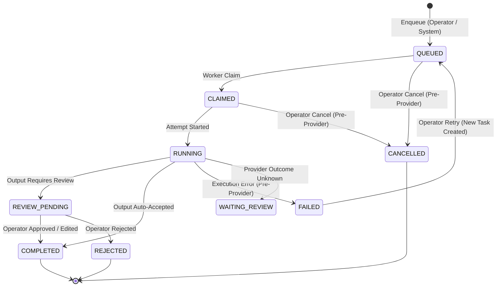

# SIREADER Phase 5.2 — Architecture & Governance Proposal

**Document Version:** 1.0.0  
**Status:** PROPOSAL — FOR REVIEW  
**Target Branch:** `phase-5-implementation`  
**Prerequisites:** Phase 5.1 COMPLETE ([PHASE_5_1_OWNER_ACCEPTANCE_REPORT.md](./PHASE_5_1_OWNER_ACCEPTANCE_REPORT.md))  
**Related Documents:** [PRODUCT_VISION.md](./PRODUCT_VISION.md) · [ROADMAP.md](./ROADMAP.md) · [PROJECT_STATE.md](./PROJECT_STATE.md) · [PHASE_5_EXECUTION_PLAN.md](./PHASE_5_EXECUTION_PLAN.md)

---

## 1. Executive Summary & Vision

Phase 5.1 established the foundational execution plane for human-supervised workforce operations (enqueue, cancel, worker scheduling pause/resume, and safe failed retry). 

**Phase 5.2 (Review, Audit, Budgets & Governance)** introduces the authoritative governance and observability plane. In accordance with the [Product Vision](./PRODUCT_VISION.md), SIREADER is not an opaque autonomous agent platform; it is a disciplined, human-supervised workforce platform where every AI action is accountable, cost-controlled, inspectable, and auditable.

Phase 5.2 delivers:
1. **Canonical Task Lifecycle Audit:** Complete, immutable, reconstructed end-to-end provenance for any task from ingestion through attempts to terminal state.
2. **Dedicated Human Output Review Subsystem:** A formal verification inbox where operators examine and adjudicate AI work outputs, strictly decoupled from trading signal approval and provider uncertainty reviews.
3. **Authoritative Budget & Cost Governance:** Centralized spend control and real-time observability leveraging Phase 4 Cost Guard, tracking hard caps, actual spend, in-flight reservations, and unknown usage.
4. **Model Escalation & Policy Engine:** Governed model tier progression (Haiku $\rightarrow$ Sonnet $\rightarrow$ Opus), deterministic provider fallbacks, sensitive-task rejection gates, and logged manual operator overrides.
5. **Interactive Governance Console:** High-signal frontend docks for review inbox management, chronological task timeline visualization, budget meters, and policy history.

---

## 2. Hard Boundaries & Invariants

| Guardrail | Enforcement Mechanism |
| :--- | :--- |
| **No Supabase LIVE Migration** | All migrations and DDL target local disposable PostgreSQL (`sireader_local` on `127.0.0.1:5432`) during development and CI. |
| **No Paid Provider Calls in Tests** | All CI and automated tests run against deterministic mock providers. Production provider remains disabled (`WORKER_LIVE_PROVIDER_ENABLED=false`). |
| **Strict Separation from Trading Systems** | **Zero interaction** with MT5, HFM, broker connections, order execution, or the existing Signal Decision Engine (`app.trade_decision`). |
| **Separation of Review Types** | `HUMAN_OUTPUT_REVIEW` (assessing AI work quality) is completely isolated from trading signal `approval_decisions` and from provider `WAITING_REVIEW` (unknown network outcomes). |
| **Single Source of Truth for Costs** | The existing Phase 4 `Cost Guard` and `ai_usage_logs` remain the authoritative financial ledger. Phase 5.2 does **not** create a duplicate calculation engine. |
| **No Merge to `main`** | All changes remain isolated on branch `phase-5-implementation`. |

---

## 3. Subsystem Architecture

### 3.1. Canonical Task Lifecycle Audit

Every task executed by the workforce must produce a continuous, unbroken chain of custody. 



#### Monotonic Event Stream & Ledger
1. **Activity Events:** Each lifecycle milestone generates an immutable `workforce_activity_events` record with:
   - `event_id`: Monotonic UUIDv7.
   - `task_id` & `correlation_id`: Linkage across retries and sub-tasks.
   - `event_type`: `TASK_ENQUEUED`, `WORKER_CLAIMED`, `ATTEMPT_STARTED`, `COST_RESERVED`, `PROVIDER_COMPLETED`, `REVIEW_QUEUED`, `REVIEW_RESOLVED`, `TASK_FINALIZED`.
   - `actor_type` & `actor_id`: `SYSTEM`, `WORKER:<worker_id>`, or `OPERATOR:<operator_id>`.
   - `payload_snapshot`: SHA-256 fingerprint of input/output data.
2. **Reconstruction Contract:** The API exposes `/api/v1/workforce/tasks/{task_id}/timeline`, returning the chronological timeline assembled deterministically from audit logs and task attempts.

---

### 3.2. Human Output Review Subsystem

The human review pipeline provides high-confidence operator oversight for tasks requiring human inspection before their outputs are considered authoritative.

#### Distinction Matrix
- **`HUMAN_OUTPUT_REVIEW` (Phase 5.2):** Validates the substantive quality, correctness, and adherence of AI-generated work (e.g. summary accuracy, research completeness).
- **`WAITING_REVIEW` (Phase 4):** A technical failure-stop state indicating provider network uncertainty (e.g. HTTP 504 where provider execution cannot be verified).
- **`approval_decisions` (Phase 3 Core):** Financial risk approval for trading signals before MT5 execution.

#### Review Lifecycle & States
```typescript
export type HumanReviewStatus = 
  | 'PENDING'    // Task output ready, awaiting human operator
  | 'APPROVED'   // Operator confirmed output as valid and accepted
  | 'EDITED'     // Operator edited/corrected output before approval
  | 'REJECTED';   // Operator rejected output (terminates task as REJECTED)
```

#### Review Record Schema
```sql
CREATE TABLE IF NOT EXISTS public.workforce_task_reviews (
    review_id VARCHAR(64) PRIMARY KEY,
    task_id VARCHAR(64) NOT NULL REFERENCES public.workforce_tasks(task_id) ON DELETE RESTRICT,
    attempt_number INTEGER NOT NULL,
    reviewer_id VARCHAR(64) NOT NULL, -- 'local_operator'
    status VARCHAR(32) NOT NULL, -- PENDING, APPROVED, EDITED, REJECTED
    original_output JSONB NOT NULL,
    adjusted_output JSONB,
    operator_notes TEXT,
    rejection_reason VARCHAR(64),
    reviewed_at TIMESTAMPTZ,
    created_at TIMESTAMPTZ NOT NULL DEFAULT NOW(),
    CONSTRAINT ck_workforce_task_review_status CHECK (
        status IN ('PENDING', 'APPROVED', 'EDITED', 'REJECTED')
    )
);
CREATE INDEX IF NOT EXISTS idx_workforce_task_reviews_pending 
ON public.workforce_task_reviews(created_at) WHERE status = 'PENDING';
```

---

### 3.3. Authoritative Budget & Cost Governance

Building upon the Phase 4 `Cost Guard` (`app.ai.cost_guard`), Phase 5.2 establishes real-time operational budget governance.

#### Five-Dimensional Budget Model
1. **Configured Hard Caps:**
   - Global daily limit (`WORKER_DAILY_BUDGET_USD` / `WORKER_DAILY_BUDGET_IDR`).
   - Per-task maximum threshold (`WORKER_MAX_TASK_COST_USD` / `WORKER_MAX_TASK_COST_RP`).
   - Per-worker monthly budget allocation.
2. **Committed Actual Spend:** Sum of finalized costs from `ai_usage_logs` where `status = 'FINALIZED'`.
3. **In-Flight Reservations:** Sum of active, unfinalized reservations (`status = 'RESERVED'`).
4. **Unknown / At-Risk Exposure:** Sum of reservations associated with `WAITING_REVIEW` tasks awaiting external provider billing reconciliation.
5. **Effective Available Capacity:**
   $$\text{Capacity} = \text{Hard Cap} - (\text{Committed Spend} + \text{Active Reservations} + \text{At-Risk Exposure})$$

#### Pre-Execution Budget Gate
Before any provider reservation is initiated, the Cost Guard validates:
- `Estimated Task Cost` $\le$ `Effective Available Capacity`.
- If capacity is exhausted, the task is **rejected pre-dispatch** with code `BUDGET_EXCEEDED` and transition to `BLOCKED_BUDGET`.
- Under no circumstances does the system silently downgrade currencies or bypass limits.

---

### 3.4. Model Escalation & Policy Engine

To optimize cost efficiency while ensuring high analytical quality, tasks follow a governed model escalation hierarchy.

#### Model Tier Hierarchy
1. **Tier 1 — FAST (`haiku`):** Intake, lightweight research, structured classification, initial summarization.
2. **Tier 2 — REASONING (`sonnet`):** Deep quantitative analysis, multi-document synthesis, cross-sectional evaluation.
3. **Tier 3 — ESCALATION (`opus`):** High-complexity conflict resolution, strategic risk assessment, edge-case anomaly auditing.

#### Escalation Triggers
- **Automated Quality Fallback:** If Tier 1 output fails validation constraints (e.g. low extraction confidence or schema parsing failure), the task is automatically escalated to Tier 2 with policy reason `LOW_CONFIDENCE_ESCALATION`.
- **Operator-Directed Escalation:** An operator reviewing a Tier 1 output in the Review Inbox may reject with recommendation `ESCALATE_TO_REASONING`.
- **Sensitive Work Rejection Gate:** Instructions matching high-risk keywords (e.g. prompt injection, unauthorized scraping, credentials, trading orders) are rejected immediately at the gateway with `POLICY_VIOLATION_SENSITIVE_WORK`.

---

## 4. API Contracts & BFF Surface

All new endpoints follow loopback same-origin security, requiring active operator session and CSRF verification.

| Method | Endpoint | Description | Scope |
| :--- | :--- | :--- | :--- |
| `GET` | `/api/v1/workforce/tasks/{id}/timeline` | Chronological task lifecycle audit trail | Read-Only |
| `GET` | `/api/v1/governance/reviews/pending` | Operator review inbox queue | Read-Only |
| `POST` | `/api/v1/commands/reviews/adjudicate` | Approve, edit, or reject a task output | Authenticated Command |
| `GET` | `/api/v1/governance/budgets/status` | Real-time budget metrics and usage ledger | Read-Only |
| `POST` | `/api/v1/commands/tasks/escalate` | Explicit model tier escalation | Authenticated Command |
| `GET` | `/api/v1/governance/policies/history` | Audit log of policy decisions & escalations | Read-Only |

---

## 5. Frontend Presentation & UI Docks

### 5.1. Human Review Inbox (`WorkforceReviewInbox.tsx`)
- Integrated into `WorkforceLiveDock` as a dedicated **Review Queue** tab.
- Displays pending task cards with:
  - Worker attribution, execution latency, and token cost.
  - Formatted output preview with Markdown/JSON rendering.
  - Side-by-side editable diff view for corrections.
  - Three action controls: **[Approve Output]**, **[Edit & Accept]**, **[Reject]**.

### 5.2. Task Timeline Visualizer (`TaskTimelineModal.tsx`)
- Clickable inspection view from any task row.
- Renders an interactive vertical steplist showing timestamp, actor, event type, state change, and associated attempt cost.

### 5.3. Budget & Cost Telemetry Meter
- Visual spend meter displayed in `LiveObservabilityDock` and `WorkforceLiveDock`.
- Color-coded progress bar: Green (<70%), Amber (70–90%), Crimson (>90%).
- Real-time breakdown: *Committed* (solid), *Reserved* (striped), *At-Risk* (hatched).

---

## 6. Implementation Checkpoints & Phasing

```
[Phase 5.1: COMPLETE]
         |
         v
[5.2.0: Architecture Proposal & Signoff] (Current)
         |
         v
[5.2.1: Lifecycle Audit Ledger & Timeline API]
         |
         v
[5.2.2: Human Output Review Subsystem & Inbox]
         |
         v
[5.2.3: Budget Governance & Cost Guard Observability]
         |
         v
[5.2.4: Model Escalation & Policy Engine]
         |
         v
[5.2.5: UI Integration, Security Audit & Browser Acceptance]
```

| Checkpoint | Scope | Output Deliverables |
| :--- | :--- | :--- |
| **5.2.0** | Architecture, Contracts, & Governance Specs | `docs/PHASE_5_2_ARCHITECTURE_PROPOSAL.md` signed off. |
| **5.2.1** | Lifecycle Audit & Reconstruction | DDL migrations, timeline route, timeline integration tests. |
| **5.2.2** | Human Review Subsystem | `workforce_task_reviews` table, adjudication command, review inbox UI. |
| **5.2.3** | Budget Governance | Authoritative spend aggregations, budget gauge UI, threshold alerts. |
| **5.2.4** | Policy Engine & Escalation | Tier escalation routing, sensitive work gate, policy history audit. |
| **5.2.5** | E2E Integration & Final Acceptance | Full browser acceptance test suite, zero console errors, acceptance report. |

---

## 7. Next Steps & Approval Gate

1. **Review & Sign-Off:** Submit this architecture proposal to the project lead (ChatGPT) for review and formal approval.
2. **Begin 5.2.1 Execution:** Upon approval, proceed with checkpoint 5.2.1 (Lifecycle Audit Ledger and Timeline API contracts).
